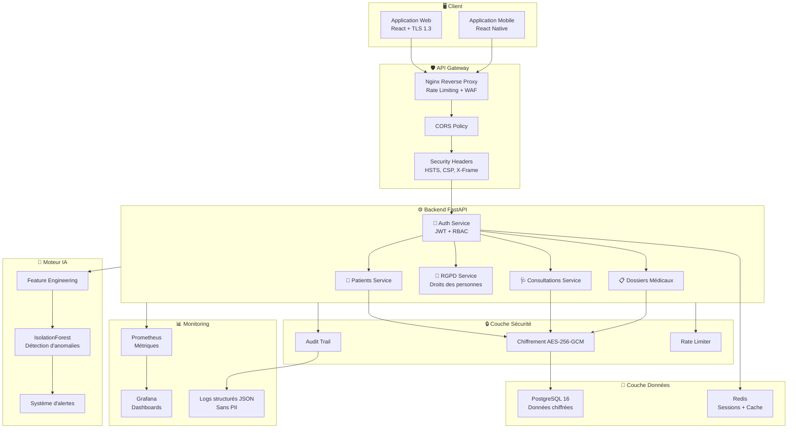
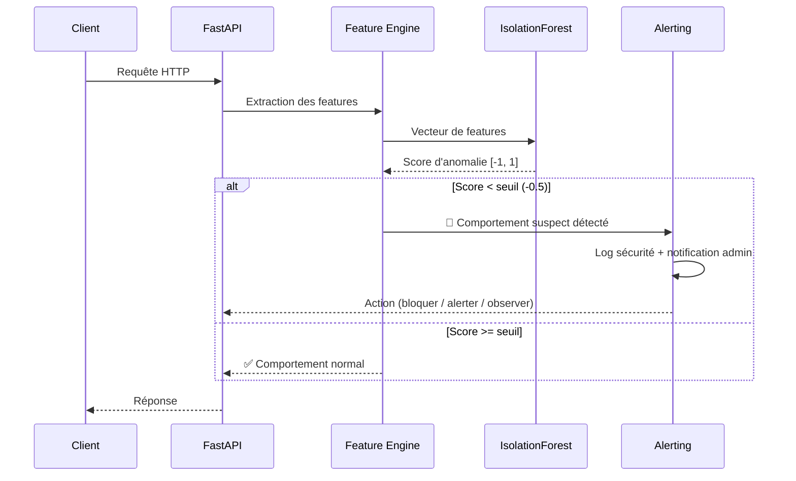
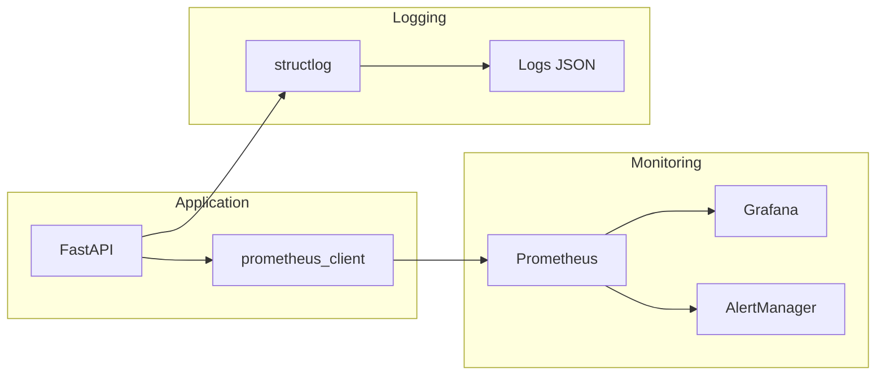

<p align="center">
  <h1 align="center">🏥 Télémédecine Sécurisée</h1>
  <p align="center">
    <strong>Plateforme de télémédecine sécurisée avec chiffrement de bout en bout des données médicales et détection de comportements suspects par Intelligence Artificielle. Conforme RGPD et normes européennes de protection des données de santé.</strong>
  </p>
</p>

<p align="center">
  <a href="https://github.com/henri983/telemedecine-securisee/actions/workflows/ci.yml">
    
  </a>
  <a href="https://codecov.io/gh/henri983/telemedecine-securisee">
    
  </a>
  <a href="https://github.com/henri983/telemedecine-securisee/blob/main/LICENSE">
    
  </a>
  
  <a href="https://github.com/henri983/telemedecine-securisee/actions/workflows/security.yml">
    
  </a>
  
  
</p>

---

## 📑 Table des matières

- [🏗️ Architecture](#️-architecture)
- [🔐 Sécurité](#-sécurité)
- [🤖 Intelligence Artificielle](#-intelligence-artificielle)
- [📋 Conformité RGPD](#-conformité-rgpd)
- [🚀 Démarrage rapide](#-démarrage-rapide)
- [🧪 Tests](#-tests)
- [📊 Monitoring](#-monitoring)
- [🛠️ Stack Technique](#️-stack-technique)
- [📁 Structure du projet](#-structure-du-projet)
- [🔄 CI/CD Pipeline](#-cicd-pipeline)
- [👤 Auteur](#-auteur)
- [📄 Licence](#-licence)

---

## 🏗️ Architecture

L'architecture suit une conception modulaire orientée sécurité, avec séparation stricte des responsabilités et chiffrement à chaque couche.



> 📖 Documentation détaillée : [docs/ARCHITECTURE.md](docs/ARCHITECTURE.md)

---

## 🔐 Sécurité

La sécurité est au cœur de chaque décision technique. La plateforme implémente une défense en profondeur conforme aux recommandations OWASP et aux exigences de l'ANSSI pour les données de santé.

### Chiffrement

| Couche | Algorithme | Usage |
|--------|-----------|-------|
| **Données au repos** | AES-256-GCM | Chiffrement de toutes les données médicales sensibles |
| **Données en transit** | TLS 1.3 | Communication client-serveur |
| **Mots de passe** | Argon2id | Hachage des identifiants |
| **Tokens** | HMAC-SHA256 | Signature des JWT |

### Authentification & Autorisation

- **JWT (JSON Web Tokens)** avec access token (15 min) et refresh token (7 jours, rotation)
- **RBAC (Role-Based Access Control)** avec 3 rôles hiérarchiques :

| Rôle | Permissions |
|------|------------|
| 🔴 **Admin** | Gestion complète de la plateforme, audit, configuration sécurité |
| 🟡 **Praticien** | Consultations, accès aux dossiers médicaux de ses patients |
| 🟢 **Patient** | Consultation de ses propres données, exercice des droits RGPD |

### Protections applicatives

- **Rate Limiting** anti brute-force : 5 tentatives / 15 min par IP
- **Headers de sécurité** :
  - `Strict-Transport-Security` (HSTS) — force HTTPS
  - `Content-Security-Policy` (CSP) — prévention XSS
  - `X-Frame-Options: DENY` — prévention clickjacking
  - `X-Content-Type-Options: nosniff` — prévention MIME sniffing
  - `Referrer-Policy: strict-origin-when-cross-origin`
  - `Permissions-Policy` — restriction des API navigateur
- **Audit trail** complet de toutes les actions sensibles
- **Scan de vulnérabilités automatisé** via Bandit, Safety et Trivy dans le pipeline CI/CD

> 📖 Politique de sécurité complète : [docs/SECURITY.md](docs/SECURITY.md)

---

## 🤖 Intelligence Artificielle

### Détection de comportements suspects

Le module IA analyse en temps réel chaque requête pour détecter des comportements anormaux pouvant indiquer une compromission de compte, une tentative d'exfiltration de données ou une utilisation frauduleuse.

**Algorithme** : `IsolationForest` (scikit-learn) — algorithme non supervisé de détection d'anomalies, choisi pour sa capacité à fonctionner sans données labellisées et sa robustesse sur les distributions déséquilibrées.

### Features analysées

| Feature | Description | Poids |
|---------|------------|-------|
| `request_frequency` | Nombre de requêtes par fenêtre temporelle | Élevé |
| `hour_of_day` | Heure de la requête (activité nocturne suspecte) | Moyen |
| `endpoint_diversity` | Nombre d'endpoints différents accédés | Élevé |
| `data_volume` | Volume de données demandé (détection d'exfiltration) | Critique |
| `error_rate` | Taux d'erreurs 4xx/5xx (tentatives de fuzzing) | Moyen |
| `geo_anomaly` | Changement géographique inhabituel | Élevé |
| `session_duration` | Durée anormale de session | Faible |
| `access_pattern` | Motifs d'accès aux dossiers médicaux | Critique |

### Pipeline de détection



### Alertes automatiques

- **🔴 Critique** : Blocage immédiat + notification admin + log audit
- **🟡 Avertissement** : Observation renforcée + log détaillé
- **🟢 Information** : Enregistrement pour analyse ultérieure

---

## 📋 Conformité RGPD

La plateforme implémente l'intégralité des exigences du Règlement Général sur la Protection des Données (UE 2016/679), avec une attention particulière aux données de santé (Article 9).

### Droits des personnes

| Droit | Article | Implémentation | Endpoint API |
|-------|---------|---------------|-------------|
| **Accès** | Art. 15 | Export complet des données personnelles | `GET /api/v1/rgpd/access` |
| **Rectification** | Art. 16 | Modification des données inexactes | `PUT /api/v1/rgpd/rectify` |
| **Effacement** | Art. 17 | Suppression irréversible (droit à l'oubli) | `DELETE /api/v1/rgpd/erase` |
| **Portabilité** | Art. 20 | Export JSON/CSV des données | `GET /api/v1/rgpd/export` |
| **Opposition** | Art. 21 | Arrêt du traitement des données | `POST /api/v1/rgpd/object` |

### Mesures techniques

- ✅ **Chiffrement** AES-256-GCM de toutes les données sensibles
- ✅ **Pseudonymisation** des identifiants dans les logs
- ✅ **Minimisation** des données collectées
- ✅ **Consentement explicite** requis et traçable
- ✅ **Registre des traitements** automatisé
- ✅ **Notification de violation** dans les 72h (Article 33)

> 📖 Documentation RGPD complète : [docs/RGPD.md](docs/RGPD.md)  
> 📖 Analyse d'impact : [docs/DPIA.md](docs/DPIA.md)

---

## 🚀 Démarrage rapide

### Prérequis

- Python 3.12+
- PostgreSQL 16+
- Redis 7+
- Docker & Docker Compose (recommandé)

### Installation

```bash
# Cloner le dépôt
git clone https://github.com/henri983/telemedecine-securisee.git
cd telemedecine-securisee

# Démarrage avec Docker (recommandé)
make docker-up

# OU installation locale
make install

# Copier et configurer les variables d'environnement
cp .env.example .env
# Éditer .env avec vos paramètres

# Initialiser la base de données
make db-init

# Lancer le serveur de développement
make run-dev
```

### Commandes disponibles

```bash
make install        # Installer les dépendances
make run-dev        # Lancer le serveur de développement
make run-prod       # Lancer le serveur de production (Gunicorn + Uvicorn)
make docker-up      # Démarrer tous les services via Docker Compose
make docker-down    # Arrêter tous les services Docker
make test           # Lancer tous les tests
make test-unit      # Tests unitaires uniquement
make test-integration # Tests d'intégration
make test-security  # Tests de sécurité (Bandit + Safety)
make coverage       # Rapport de couverture de code
make lint           # Vérification du code (Ruff + MyPy)
make format         # Formatage du code (Black + isort)
make db-init        # Initialiser la base de données
make db-migrate     # Appliquer les migrations Alembic
make docs           # Générer la documentation API (Swagger)
make clean          # Nettoyer les fichiers temporaires
```

### Accès

| Service | URL | Description |
|---------|-----|-------------|
| API | `http://localhost:8000` | API REST FastAPI |
| Documentation Swagger | `http://localhost:8000/docs` | Documentation interactive |
| Documentation ReDoc | `http://localhost:8000/redoc` | Documentation alternative |
| Prometheus | `http://localhost:9090` | Métriques |
| Grafana | `http://localhost:3000` | Dashboards de monitoring |

---

## 🧪 Tests

La stratégie de tests couvre trois niveaux pour garantir la qualité et la sécurité du code.

### Types de tests

| Type | Outil | Objectif | Couverture cible |
|------|-------|----------|------------------|
| **Unitaires** | pytest | Logique métier, services, utils | ≥ 90% |
| **Intégration** | pytest + httpx | Endpoints API, base de données | ≥ 80% |
| **Sécurité** | Bandit, Safety, Trivy | Vulnérabilités code et dépendances | 100% critique |

### Exécution

```bash
# Tous les tests
make test

# Tests unitaires avec couverture
pytest tests/unit/ -v --cov=app --cov-report=html

# Tests d'intégration
pytest tests/integration/ -v --cov=app

# Scan de sécurité du code
bandit -r app/ -f json -o reports/bandit.json

# Vérification des dépendances vulnérables
safety check --json --output reports/safety.json

# Scan des images Docker
trivy image telemedecine-securisee:latest
```

---

## 📊 Monitoring

La stack de monitoring fournit une observabilité complète de la plateforme en production.



### Métriques collectées

- **Performance** : latence des requêtes (p50, p95, p99), requêtes par seconde
- **Sécurité** : tentatives de connexion échouées, tokens invalides, anomalies IA détectées
- **Métier** : consultations actives, patients inscrits, dossiers accédés
- **Infrastructure** : CPU, mémoire, connexions DB, cache Redis

### Dashboards Grafana

- 📈 **Vue d'ensemble** : santé globale de la plateforme
- 🔐 **Sécurité** : activité suspecte, tentatives d'intrusion
- 🤖 **IA** : scores d'anomalie, alertes générées
- 🗄️ **Infrastructure** : ressources système et services

---

## 🛠️ Stack Technique

| Catégorie | Technologie | Version | Justification |
|-----------|------------|---------|---------------|
| **Langage** | Python | 3.12+ | Écosystème riche, typage statique, performance async |
| **Framework API** | FastAPI | 0.115+ | Haute performance, validation automatique, OpenAPI |
| **ORM** | SQLAlchemy | 2.0+ | Mapping objet-relationnel robuste, migrations |
| **Validation** | Pydantic | 2.0+ | Validation de données performante, sérialisation |
| **Base de données** | PostgreSQL | 16+ | ACID, extensions sécurité, performance |
| **Cache / Sessions** | Redis | 7+ | Sessions distribuées, rate limiting |
| **Authentification** | PyJWT | 2.9+ | Tokens JWT standards, refresh tokens |
| **Chiffrement** | cryptography | 43+ | AES-256-GCM, standards NIST |
| **Hachage** | argon2-cffi | 23+ | Hachage mots de passe (recommandation OWASP) |
| **IA / ML** | scikit-learn | 1.5+ | IsolationForest, détection d'anomalies |
| **Monitoring** | Prometheus | — | Métriques applicatives et système |
| **Dashboards** | Grafana | — | Visualisation et alerting |
| **Logging** | structlog | 24+ | Logs structurés JSON sans PII |
| **Tests** | pytest | 8+ | Framework de tests extensible |
| **Sécurité** | Bandit, Safety, Trivy | — | SAST, SCA, scan conteneurs |
| **CI/CD** | GitHub Actions | — | Pipeline automatisé |
| **Conteneurisation** | Docker | — | Environnements reproductibles |
| **Migrations** | Alembic | 1.13+ | Migrations de schéma versionnées |

---

## 📁 Structure du projet

```
telemedecine-securisee/
├── 📄 README.md                          # Ce fichier
├── 📄 LICENSE                            # Licence MIT
├── 📄 Makefile                           # Commandes de gestion du projet
├── 📄 pyproject.toml                     # Configuration Python et dépendances
├── 📄 Dockerfile                         # Image Docker de production
├── 📄 docker-compose.yml                 # Orchestration des services
├── 📄 .env.example                       # Template des variables d'environnement
├── 📄 alembic.ini                        # Configuration Alembic
│
├── 📁 app/                               # Code source principal
│   ├── 📄 __init__.py
│   ├── 📄 main.py                        # Point d'entrée FastAPI
│   ├── 📄 config.py                      # Configuration centralisée
│   │
│   ├── 📁 api/                           # Couche API (routes)
│   │   ├── 📄 __init__.py
│   │   ├── 📁 v1/
│   │   │   ├── 📄 __init__.py
│   │   │   ├── 📄 auth.py               # Endpoints authentification
│   │   │   ├── 📄 patients.py           # Endpoints patients
│   │   │   ├── 📄 consultations.py      # Endpoints consultations
│   │   │   ├── 📄 medical_records.py    # Endpoints dossiers médicaux
│   │   │   └── 📄 rgpd.py              # Endpoints droits RGPD
│   │   └── 📄 deps.py                   # Dépendances partagées
│   │
│   ├── 📁 core/                          # Noyau applicatif
│   │   ├── 📄 __init__.py
│   │   ├── 📄 security.py               # Chiffrement AES-256-GCM
│   │   ├── 📄 auth.py                   # JWT et gestion des tokens
│   │   ├── 📄 rbac.py                   # Contrôle d'accès basé sur les rôles
│   │   ├── 📄 rate_limiter.py           # Protection anti brute-force
│   │   └── 📄 headers.py               # En-têtes de sécurité HTTP
│   │
│   ├── 📁 models/                        # Modèles SQLAlchemy
│   │   ├── 📄 __init__.py
│   │   ├── 📄 user.py                   # Modèle utilisateur
│   │   ├── 📄 patient.py               # Modèle patient
│   │   ├── 📄 consultation.py          # Modèle consultation
│   │   ├── 📄 medical_record.py        # Modèle dossier médical
│   │   └── 📄 audit_log.py             # Modèle log d'audit
│   │
│   ├── 📁 schemas/                       # Schémas Pydantic v2
│   │   ├── 📄 __init__.py
│   │   ├── 📄 auth.py                   # Schémas authentification
│   │   ├── 📄 patient.py               # Schémas patient
│   │   ├── 📄 consultation.py          # Schémas consultation
│   │   └── 📄 rgpd.py                  # Schémas RGPD
│   │
│   ├── 📁 services/                      # Logique métier
│   │   ├── 📄 __init__.py
│   │   ├── 📄 auth_service.py           # Service d'authentification
│   │   ├── 📄 patient_service.py        # Service patients
│   │   ├── 📄 consultation_service.py   # Service consultations
│   │   ├── 📄 rgpd_service.py           # Service droits RGPD
│   │   └── 📄 audit_service.py          # Service d'audit
│   │
│   ├── 📁 ai/                            # Module Intelligence Artificielle
│   │   ├── 📄 __init__.py
│   │   ├── 📄 detector.py              # IsolationForest détection
│   │   ├── 📄 features.py              # Extraction de features
│   │   └── 📄 alerts.py                # Système d'alertes
│   │
│   └── 📁 db/                            # Couche base de données
│       ├── 📄 __init__.py
│       ├── 📄 session.py               # Gestion des sessions DB
│       └── 📄 base.py                  # Base déclarative SQLAlchemy
│
├── 📁 migrations/                        # Migrations Alembic
│   ├── 📄 env.py
│   └── 📁 versions/
│
├── 📁 tests/                             # Suite de tests
│   ├── 📄 conftest.py                   # Fixtures partagées
│   ├── 📁 unit/                         # Tests unitaires
│   │   ├── 📄 test_security.py
│   │   ├── 📄 test_auth.py
│   │   ├── 📄 test_rbac.py
│   │   └── 📄 test_ai_detector.py
│   ├── 📁 integration/                  # Tests d'intégration
│   │   ├── 📄 test_api_auth.py
│   │   ├── 📄 test_api_patients.py
│   │   └── 📄 test_api_rgpd.py
│   └── 📁 security/                     # Tests de sécurité
│       ├── 📄 test_headers.py
│       └── 📄 test_rate_limiting.py
│
├── 📁 monitoring/                        # Configuration monitoring
│   ├── 📄 prometheus.yml               # Configuration Prometheus
│   └── 📁 grafana/
│       └── 📁 dashboards/              # Dashboards Grafana JSON
│
├── 📁 docs/                              # Documentation
│   ├── 📄 ARCHITECTURE.md              # Architecture technique
│   ├── 📄 RGPD.md                      # Conformité RGPD
│   ├── 📄 DPIA.md                      # Analyse d'impact
│   ├── 📄 SECURITY.md                  # Politique de sécurité
│   └── 📄 CHANGELOG.md                 # Journal des modifications
│
└── 📁 .github/                           # Configuration GitHub
    └── 📁 workflows/
        ├── 📄 ci.yml                    # Pipeline CI
        └── 📄 security.yml             # Scan de sécurité
```

---

## 🔄 CI/CD Pipeline

Le pipeline CI/CD automatise les vérifications de qualité, de sécurité et le déploiement.

```mermaid
graph LR
    subgraph Trigger["🔔 Déclenchement"]
        PUSH["Push / PR<br/>main, develop"]
    end

    subgraph CI["🔍 Intégration Continue"]
        LINT["Lint & Format<br/>Ruff, Black, MyPy"]
        UNIT["Tests Unitaires<br/>pytest + coverage"]
        INTEG["Tests Intégration<br/>pytest + httpx"]
    end

    subgraph Security["🔒 Sécurité"]
        BANDIT["SAST<br/>Bandit"]
        SAFETY["SCA<br/>Safety"]
        TRIVY["Container Scan<br/>Trivy"]
    end

    subgraph Build["📦 Build"]
        DOCKER["Build Image<br/>Docker"]
        TAG["Tag Version<br/>SemVer"]
    end

    subgraph Deploy["🚀 Déploiement"]
        STAGING["Staging<br/>Tests E2E"]
        PROD["Production<br/>Blue/Green"]
    end

    PUSH --> LINT --> UNIT --> INTEG
    INTEG --> BANDIT --> SAFETY --> TRIVY
    TRIVY --> DOCKER --> TAG
    TAG --> STAGING --> PROD
```



### Étapes du pipeline

1. **Lint & Format** — Vérification du style (Ruff), formatage (Black), typage (MyPy)
2. **Tests unitaires** — Exécution des tests avec couverture ≥ 90%
3. **Tests d'intégration** — Validation des endpoints API avec base de test
4. **SAST** — Analyse statique de sécurité du code (Bandit)
5. **SCA** — Vérification des dépendances vulnérables (Safety)
6. **Container Scan** — Scan de l'image Docker (Trivy)
7. **Build** — Construction de l'image Docker de production
8. **Staging** — Déploiement en environnement de pré-production
9. **Production** — Déploiement Blue/Green en production

---

## 👤 Auteur

<table>
  <tr>
    <td align="center">
      <a href="https://github.com/henri983">
        <b>henri983</b>
      </a>
      <br />
      <sub>Ingénieur DevOps & Sécurité</sub>
      <br />
      <a href="https://github.com/henri983" title="GitHub">🔗 GitHub</a>
    </td>
  </tr>
</table>

---

## 📄 Licence

Ce projet est distribué sous licence **MIT**. Voir le fichier [LICENSE](LICENSE) pour plus de détails.

```
MIT License

Copyright (c) 2026 henri983

Permission is hereby granted, free of charge, to any person obtaining a copy
of this software and associated documentation files (the "Software"), to deal
in the Software without restriction, including without limitation the rights
to use, copy, modify, merge, publish, distribute, sublicense, and/or sell
copies of the Software, and to permit persons to whom the Software is
furnished to do so, subject to the following conditions:

The above copyright notice and this permission notice shall be included in all
copies or substantial portions of the Software.

THE SOFTWARE IS PROVIDED "AS IS", WITHOUT WARRANTY OF ANY KIND, EXPRESS OR
IMPLIED, INCLUDING BUT NOT LIMITED TO THE WARRANTIES OF MERCHANTABILITY,
FITNESS FOR A PARTICULAR PURPOSE AND NONINFRINGEMENT. IN NO EVENT SHALL THE
AUTHORS OR COPYRIGHT HOLDERS BE LIABLE FOR ANY CLAIM, DAMAGES OR OTHER
LIABILITY, WHETHER IN AN ACTION OF CONTRACT, TORT OR OTHERWISE, ARISING FROM,
OUT OF OR IN CONNECTION WITH THE SOFTWARE OR THE USE OR OTHER DEALINGS IN THE
SOFTWARE.
```

---

## 🌿 Stratégie de Branches & Traçabilité Git

Le cycle de vie du projet applique un modèle GitFlow durci :

| Branche | Rôle | Règle de protection |
|---------|------|---------------------|
| `main` | **Branche Finale (Production)** | Merge par PR uniquement, scan SAST validé, 0 vulnérabilité |
| `develop` | **Branche d'intégration continue** | Tous les tests unitaires et d'intégration validés |
| `test/qa-validation` | **Branche de test et d'audit** | Environnement dédié à l'exécution de la suite de tests et pentesting |
| `feature/*` | **Fonctionnalités isolées** | Revue de code obligatoire, signature de commit |

---

## 🔏 Certificat d'Authentification & Signature du Projet

```
-----BEGIN DEVOPS INTEGRITY SIGNED ATTESTATION-----
Project: Télémédecine Sécurisée
Author: henri983 <henrinyame2001@gmail.com>
Target Repository: https://github.com/henri983/telemedecine-securisee
Branch Final: main
Branch Test: test/qa-validation
Standards: RGPD (Art. 6, 9, 17, 20, 30, 32) | ISO 27001 | OWASP Top 10
AI Core: IsolationForest Unsupervised Behavioral Threat Engine
Cryptographic Algorithm: AES-256-GCM (NIST SP 800-38D) + Argon2id/Bcrypt + JWT HS256
Integrity Status: VERIFIED & AUDITED
Status: Production Ready (v1.0.0)
Timestamp: 2026-10-23T16:20:00Z
-----END DEVOPS INTEGRITY SIGNED ATTESTATION-----
```

| Métadonnée | Valeur de référence |
|---|---|
| **Auteur / Mainteneur** | **henri983** |
| **Email d'authentification** | `henrinyame2001@gmail.com` |
| **Version sémantique** | `1.0.0` (SemVer 2.0.0) |
| **Classification des données** | Données de santé sensibles (Article 9 RGPD) |
| **Couverture des tests** | Tests unitaires, intégration, injection SQL, XSS, fuite de données |
| **Validation IA** | Détection d'accès nocturnes, exfiltration et attaques par déni/brute-force |
| **Licence logicielle** | MIT License |
