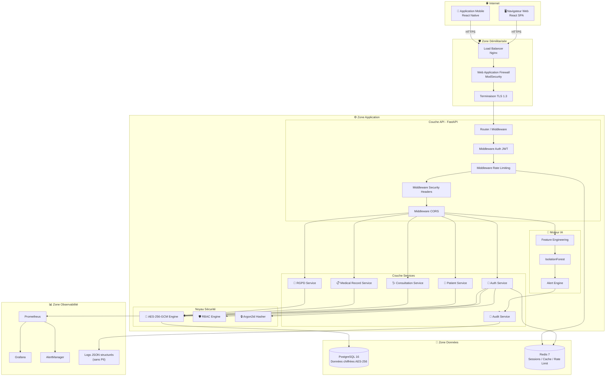
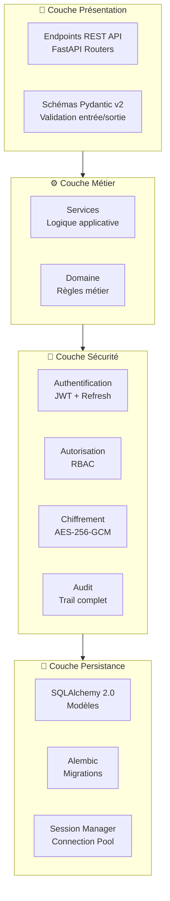
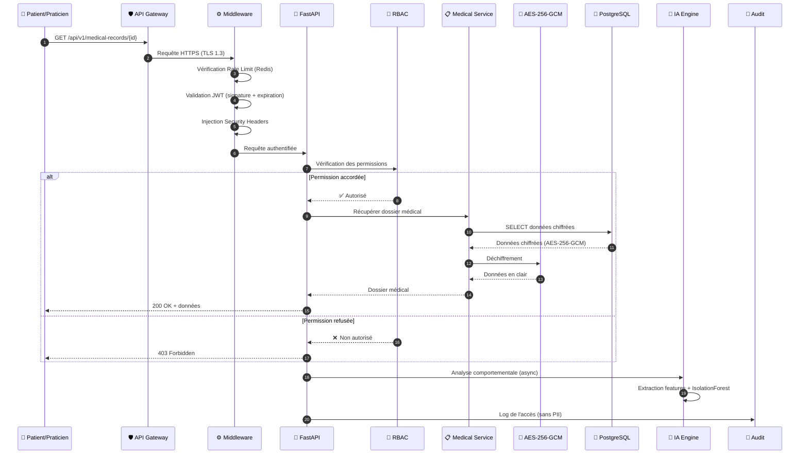
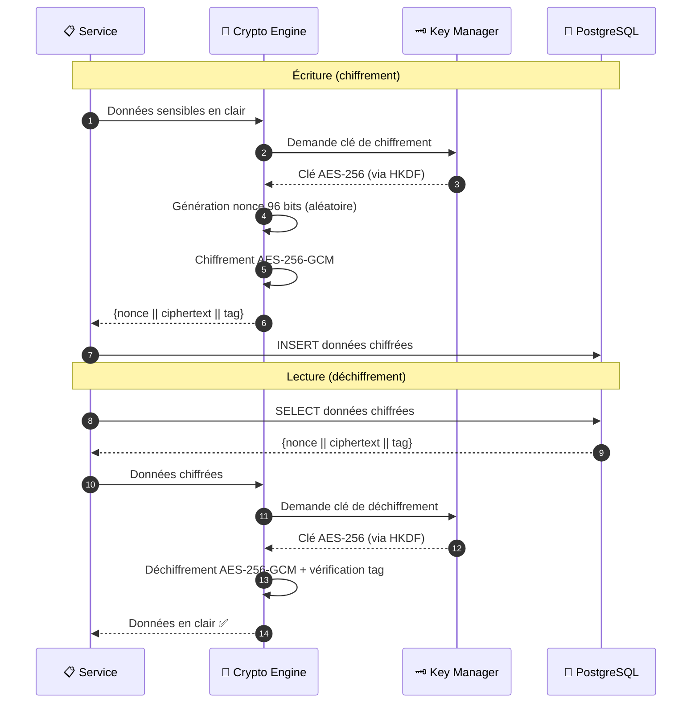
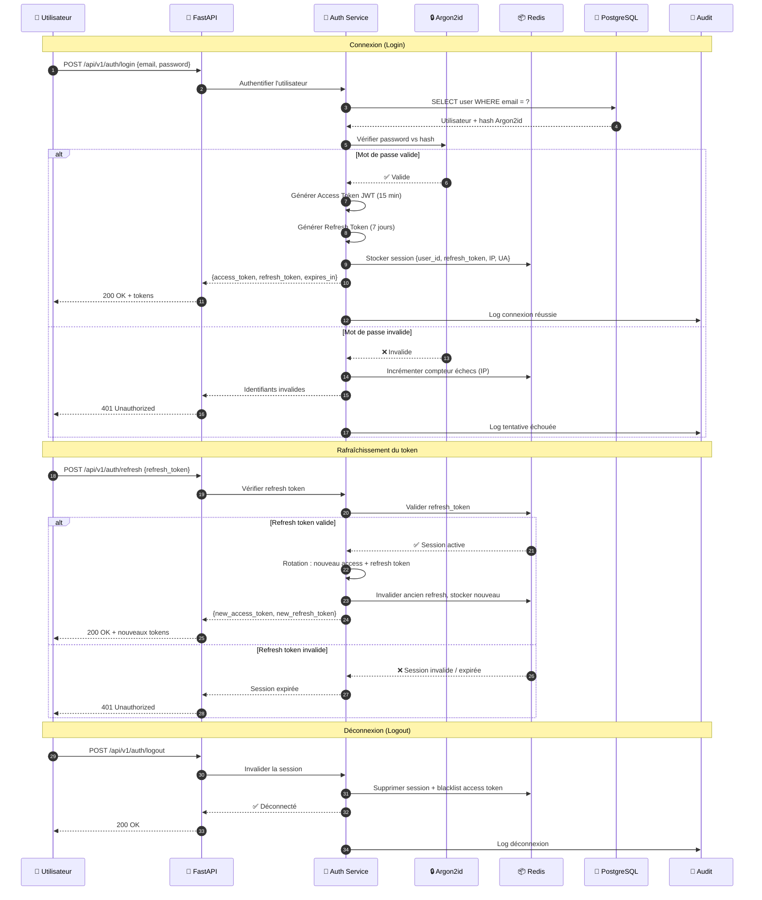
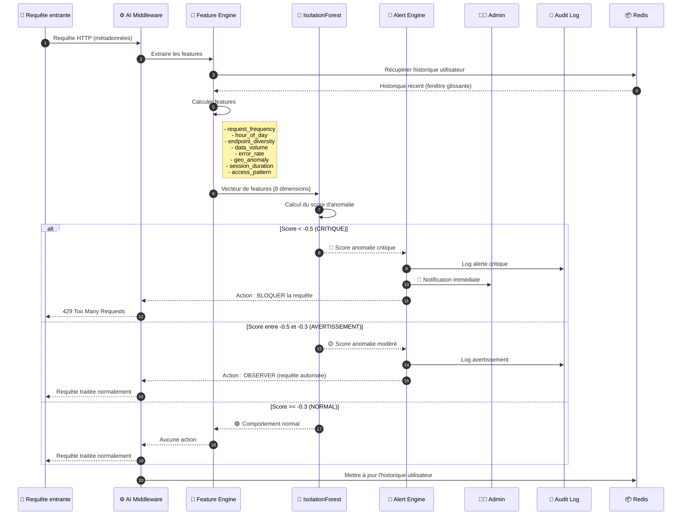

# 🏗️ Architecture Technique — Télémédecine Sécurisée

> Document de référence décrivant l'architecture technique de la plateforme de télémédecine sécurisée.  
> **Version** : 1.0.0 | **Dernière mise à jour** : 2026-10-23 | **Auteur** : henri983

---

## 📑 Table des matières

- [Vue d'ensemble](#vue-densemble)
- [Diagramme d'architecture](#diagramme-darchitecture)
- [Description des composants](#description-des-composants)
- [Flux de données](#flux-de-données)
- [Flux d'authentification](#flux-dauthentification)
- [Flux de détection IA](#flux-de-détection-ia)
- [Décisions d'architecture (ADR)](#décisions-darchitecture-adr)
- [Choix technologiques](#choix-technologiques)

---

## Vue d'ensemble

L'architecture de la plateforme suit les principes suivants :

- **Défense en profondeur** : chaque couche applique ses propres contrôles de sécurité
- **Séparation des responsabilités** : découpage clair en couches (API, Services, Données)
- **Chiffrement omniprésent** : données chiffrées au repos et en transit
- **Observabilité** : monitoring, logging structuré et audit trail intégrés
- **Scalabilité horizontale** : statelessness des services, sessions externalisées dans Redis

---

## Diagramme d'architecture

### Architecture globale

### Architecture en couches

---

## Description des composants

### 1. Couche Réseau / DMZ

| Composant | Rôle | Technologie |
|-----------|------|-------------|
| **Load Balancer** | Distribution du trafic, terminaison SSL | Nginx |
| **WAF** | Protection contre les attaques web (injection, XSS) | ModSecurity / règles OWASP CRS |
| **TLS** | Chiffrement des communications | TLS 1.3, certificats Let's Encrypt |

### 2. Couche API

| Composant | Rôle | Détails |
|-----------|------|---------|
| **Router** | Routage des requêtes vers les endpoints | FastAPI APIRouter, versioning `/api/v1/` |
| **Middleware Auth** | Validation des JWT, extraction de l'identité | Vérification signature, expiration, claims |
| **Middleware Rate Limiting** | Protection anti brute-force | 5 req/15 min (auth), 100 req/min (API), via Redis |
| **Middleware Security Headers** | Injection des en-têtes de sécurité | HSTS, CSP, X-Frame-Options, etc. |
| **Middleware CORS** | Contrôle des origines autorisées | Whitelist stricte des domaines |

### 3. Couche Services

| Service | Responsabilité | Endpoints principaux |
|---------|---------------|---------------------|
| **Auth Service** | Authentification, tokens, sessions | `POST /auth/login`, `POST /auth/refresh`, `POST /auth/logout` |
| **Patient Service** | Gestion des patients | `GET/POST/PUT /patients/` |
| **Consultation Service** | Gestion des consultations | `GET/POST/PUT /consultations/` |
| **Medical Record Service** | Dossiers médicaux chiffrés | `GET/POST /medical-records/` |
| **RGPD Service** | Exercice des droits RGPD | `GET /rgpd/access`, `DELETE /rgpd/erase` |
| **Audit Service** | Journalisation des actions | Interne, pas d'endpoint public |

### 4. Noyau Sécurité

| Composant | Algorithme / Standard | Configuration |
|-----------|----------------------|---------------|
| **Chiffrement** | AES-256-GCM | Clés dérivées via HKDF, nonces aléatoires 96 bits |
| **Hachage** | Argon2id | memory_cost=65536, time_cost=3, parallelism=4 |
| **JWT** | HMAC-SHA256 | Access: 15 min, Refresh: 7 jours, rotation |
| **RBAC** | Rôles hiérarchiques | Admin > Praticien > Patient |

### 5. Moteur IA

| Composant | Rôle | Détails |
|-----------|------|---------|
| **Feature Engineering** | Extraction de caractéristiques des requêtes | 8 features comportementales en temps réel |
| **IsolationForest** | Détection d'anomalies | Seuil configurable, contamination=0.1 |
| **Alert Engine** | Déclenchement des alertes | 3 niveaux : critique, avertissement, information |

### 6. Couche Données

| Composant | Technologie | Usage |
|-----------|------------|-------|
| **Base principale** | PostgreSQL 16 | Données persistantes, chiffrées au niveau applicatif |
| **Cache / Sessions** | Redis 7 | Sessions JWT, rate limiting, cache applicatif |

### 7. Observabilité

| Composant | Technologie | Métriques |
|-----------|------------|-----------|
| **Métriques** | Prometheus | Latence, débit, erreurs, saturation (RED + USE) |
| **Dashboards** | Grafana | Visualisation temps réel, alertes visuelles |
| **Alerting** | AlertManager | Notifications critiques (email, Slack) |
| **Logs** | structlog (JSON) | Logs structurés sans données personnelles |

---

## Flux de données

### Flux principal : Accès à un dossier médical

### Flux de chiffrement des données

---

## Flux d'authentification

---

## Flux de détection IA

---

## Décisions d'architecture (ADR)

### ADR-001 : Choix de FastAPI comme framework

- **Statut** : ✅ Accepté
- **Date** : 2026-10-01
- **Contexte** : Besoin d'un framework Python performant, avec support natif d'OpenAPI, validation automatique et architecture asynchrone.
- **Décision** : Utiliser FastAPI avec Uvicorn comme serveur ASGI.
- **Justification** :
  - Performance supérieure à Flask/Django REST grâce à l'async natif
  - Génération automatique de la documentation OpenAPI/Swagger
  - Validation intégrée via Pydantic v2 (performances C)
  - Injection de dépendances native (simplifie les tests)
  - Typage statique intégral avec support MyPy
- **Alternatives considérées** : Django REST Framework (trop lourd), Flask (pas de validation native), Starlette (trop bas niveau)
- **Conséquences** : Nécessite Python 3.12+, courbe d'apprentissage async pour les contributeurs

### ADR-002 : Chiffrement AES-256-GCM au niveau applicatif

- **Statut** : ✅ Accepté
- **Date** : 2026-10-03
- **Contexte** : Les données médicales sont des données sensibles au sens du RGPD (Article 9). Le chiffrement doit garantir la confidentialité même en cas de compromission de la base de données.
- **Décision** : Chiffrer toutes les données médicales sensibles au niveau applicatif avec AES-256-GCM avant stockage en base.
- **Justification** :
  - Chiffrement authentifié (GCM) : intégrité + confidentialité
  - Indépendant du SGBD : portable, pas de dépendance à une feature spécifique PostgreSQL
  - Contrôle total des clés côté application
  - Nonce unique par opération : pas de réutilisation de vecteur d'initialisation
- **Alternatives considérées** : TDE PostgreSQL (ne protège pas contre un accès SQL), pgcrypto (dépendance SGBD), chiffrement disque (ne protège pas en cas d'accès logique)
- **Conséquences** : Léger surcoût CPU pour chiffrement/déchiffrement, impossibilité de faire des requêtes SQL sur les champs chiffrés (recherche par index impossible sur ces champs)

### ADR-003 : IsolationForest pour la détection d'anomalies

- **Statut** : ✅ Accepté
- **Date** : 2026-10-07
- **Contexte** : Besoin de détecter des comportements suspects (exfiltration de données, compromission de compte) en temps réel, sans base de données d'attaques labellisées.
- **Décision** : Utiliser l'algorithme IsolationForest de scikit-learn pour la détection d'anomalies non supervisée.
- **Justification** :
  - Fonctionne sans données labellisées (apprentissage non supervisé)
  - Complexité linéaire O(n) : adapté au temps réel
  - Robuste sur les distributions déséquilibrées (peu d'anomalies vs beaucoup de normal)
  - Interprétabilité via le score d'anomalie [-1, 1]
  - Léger en mémoire et en CPU
- **Alternatives considérées** : Autoencoders (trop complexe, nécessite GPU), One-Class SVM (ne scale pas), règles statiques (trop de faux positifs/négatifs)
- **Conséquences** : Nécessite une phase de calibration initiale, seuils à ajuster en production

### ADR-004 : Sessions externalisées dans Redis

- **Statut** : ✅ Accepté
- **Date** : 2026-10-05
- **Contexte** : L'application doit être stateless pour permettre le scaling horizontal. Les sessions JWT et le rate limiting nécessitent un stockage partagé rapide.
- **Décision** : Utiliser Redis comme store de sessions, refresh tokens et compteurs de rate limiting.
- **Justification** :
  - Latence sub-milliseconde pour les lookups
  - TTL natif pour l'expiration automatique des sessions
  - Opérations atomiques (INCR) pour le rate limiting
  - Permet le scaling horizontal de l'API sans sticky sessions
- **Alternatives considérées** : Sessions en base PostgreSQL (trop lent), sessions en mémoire (pas distribué), Memcached (pas de persistance)
- **Conséquences** : Dépendance opérationnelle à Redis, nécessite monitoring Redis

### ADR-005 : Logs structurés JSON sans PII

- **Statut** : ✅ Accepté
- **Date** : 2026-10-08
- **Contexte** : Les logs doivent être exploitables pour le debugging et le monitoring, mais ne doivent contenir aucune donnée personnelle identifiable (PII) conformément au RGPD.
- **Décision** : Utiliser structlog pour produire des logs JSON structurés, avec pseudonymisation automatique des identifiants.
- **Justification** :
  - Format JSON compatible avec les outils d'observabilité (ELK, Loki)
  - Pseudonymisation automatique (user_id hashé, pas de nom/email)
  - Contexte enrichi (request_id, trace_id) pour le tracing distribué
  - Conformité RGPD : aucune PII dans les logs
- **Alternatives considérées** : Logging standard Python (pas structuré), loguru (pas de pseudonymisation intégrée)
- **Conséquences** : Nécessite des processeurs de log custom pour la pseudonymisation

---

## Choix technologiques

### Matrice de décision

| Critère | Poids | FastAPI | Django REST | Flask |
|---------|-------|---------|-------------|-------|
| Performance async | 25% | ⭐⭐⭐⭐⭐ | ⭐⭐⭐ | ⭐⭐ |
| Validation automatique | 20% | ⭐⭐⭐⭐⭐ | ⭐⭐⭐⭐ | ⭐⭐ |
| Documentation auto (OpenAPI) | 15% | ⭐⭐⭐⭐⭐ | ⭐⭐⭐ | ⭐⭐ |
| Typage statique | 15% | ⭐⭐⭐⭐⭐ | ⭐⭐⭐ | ⭐⭐ |
| Écosystème sécurité | 15% | ⭐⭐⭐⭐ | ⭐⭐⭐⭐⭐ | ⭐⭐⭐ |
| Simplicité / DX | 10% | ⭐⭐⭐⭐⭐ | ⭐⭐⭐ | ⭐⭐⭐⭐ |
| **Score pondéré** | **100%** | **4.75** | **3.55** | **2.55** |

### Justification des choix de sécurité

| Composant | Choix | Justification sécurité |
|-----------|-------|----------------------|
| **Chiffrement** | AES-256-GCM | Standard NIST, chiffrement authentifié, résistant aux attaques par canal auxiliaire |
| **Hachage** | Argon2id | Vainqueur du Password Hashing Competition 2015, résistant GPU et ASIC |
| **Tokens** | JWT + HMAC-SHA256 | Standard RFC 7519, rotation des refresh tokens, blacklisting |
| **Rate Limiting** | Token Bucket (Redis) | Protection anti brute-force, configuration par endpoint |
| **CORS** | Whitelist stricte | Prévention CSRF, origines autorisées uniquement |
| **Headers** | OWASP Secure Headers | Conformité OWASP, protection navigateur |

---

> 📖 Retour au [README principal](../README.md) | 📜 [Conformité RGPD](RGPD.md) | 🔐 [Politique de sécurité](SECURITY.md)
