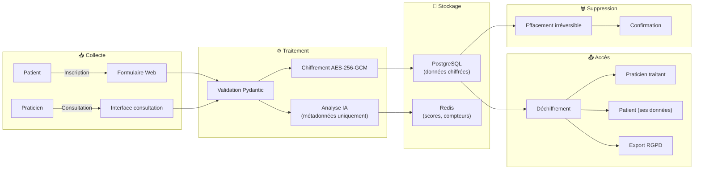

# 📊 Analyse d'Impact relative à la Protection des Données (DPIA)

> Data Protection Impact Assessment — Article 35 du RGPD (UE 2016/679)  
> **Projet** : Télémédecine Sécurisée  
> **Version** : 1.0.0 | **Date** : 2026-10-23 | **Auteur** : henri983  
> **Classification** : Confidentiel — Données de santé

---

## 📑 Table des matières

- [1. Description du traitement](#1-description-du-traitement)
- [2. Nécessité et proportionnalité](#2-nécessité-et-proportionnalité)
- [3. Identification des risques](#3-identification-des-risques)
- [4. Évaluation des risques](#4-évaluation-des-risques)
- [5. Mesures d'atténuation](#5-mesures-datténuation)
- [6. Matrice des risques](#6-matrice-des-risques)
- [7. Avis du DPO](#7-avis-du-dpo)
- [8. Plan d'action](#8-plan-daction)
- [9. Validation et révision](#9-validation-et-révision)

---

## 1. Description du traitement

### 1.1 Nature du traitement

| Élément | Description |
|---------|-------------|
| **Nom du traitement** | Plateforme de télémédecine sécurisée avec détection IA |
| **Responsable du traitement** | Opérateur de la plateforme Télémédecine Sécurisée |
| **Finalité principale** | Fourniture d'un service de télémédecine (consultations à distance) |
| **Finalités secondaires** | Détection de comportements suspects par IA, audit de sécurité |
| **Technologie utilisée** | API REST (FastAPI), chiffrement AES-256-GCM, IsolationForest (IA) |
| **Portée géographique** | France et Union Européenne |

### 1.2 Données traitées

| Catégorie | Données | Sensibilité | Chiffrement |
|-----------|---------|-------------|-------------|
| **Identification** | Nom, prénom, email, téléphone | Personnelle | ✅ AES-256-GCM |
| **Authentification** | Mot de passe (hashé), tokens JWT | Personnelle | ✅ Argon2id / HMAC-SHA256 |
| **Données de santé** | Antécédents, allergies, traitements, diagnostics, prescriptions | **Sensible (Art. 9)** | ✅ AES-256-GCM |
| **Données de consultation** | Date, motif, notes cliniques, ordonnances | **Sensible (Art. 9)** | ✅ AES-256-GCM |
| **Métadonnées techniques** | Adresse IP (hashée), user-agent, horodatage | Personnelle | ✅ Pseudonymisée |
| **Données comportementales** | Fréquence de requêtes, patterns d'accès, volumes | Personnelle | ✅ Pseudonymisée |

### 1.3 Personnes concernées

| Catégorie | Nombre estimé | Vulnérabilité |
|-----------|---------------|---------------|
| **Patients** | Potentiellement illimité | 🔴 Élevée (données de santé, possiblement mineurs ou personnes âgées) |
| **Praticiens** | Dizaines à centaines | 🟡 Modérée (données professionnelles) |
| **Administrateurs** | Quelques unités | 🟢 Faible (données de gestion) |

### 1.4 Flux de données

---

## 2. Nécessité et proportionnalité

### 2.1 Nécessité du traitement

| Question | Réponse |
|----------|---------|
| Le traitement est-il nécessaire à la finalité ? | ✅ **Oui** — La télémédecine nécessite le traitement de données de santé pour fournir le service médical |
| Existe-t-il une alternative moins intrusive ? | ❌ **Non** — Les consultations médicales à distance requièrent par nature le traitement de données de santé |
| Le traitement est-il proportionné ? | ✅ **Oui** — Seules les données strictement nécessaires sont collectées (minimisation) |
| Les personnes sont-elles informées ? | ✅ **Oui** — Politique de confidentialité claire, consentement explicite |

### 2.2 Proportionnalité

#### Minimisation des données (Article 5.1.c)

| Donnée | Collectée | Justification |
|--------|-----------|---------------|
| Nom, prénom | ✅ | Identification du patient |
| Email | ✅ | Communication et authentification |
| Téléphone | ✅ | Contact d'urgence |
| Date de naissance | ✅ | Calcul de l'âge (pertinence médicale) |
| Adresse postale | ❌ | Non nécessaire pour la télémédecine |
| Numéro de sécurité sociale | ❌ | Non nécessaire (pas de facturation CPAM directe) |
| Données biométriques | ❌ | Non nécessaire |
| Antécédents médicaux | ✅ | Nécessaire à la consultation médicale |
| Données de navigation | ❌ | Non collectées (pas de tracking) |

#### Limitation de la conservation (Article 5.1.e)

| Donnée | Durée de conservation | Justification légale |
|--------|----------------------|---------------------|
| Données de compte | Durée de la relation + 3 ans | Prescription civile |
| Données médicales | 20 ans après dernière consultation | Art. R.1112-7 Code de la Santé Publique |
| Logs d'audit | 6 ans | Prescription légale |
| Données IA (métadonnées) | 12 mois glissants | Proportionnalité |
| Sessions / tokens | Durée de validité du token | Sécurité |

---

## 3. Identification des risques

### 3.1 Risques pour les droits et libertés des personnes

| # | Risque | Source de risque | Impact potentiel |
|---|--------|-----------------|------------------|
| R1 | **Accès non autorisé aux données de santé** | Attaque externe (hacking), compromission de compte | Atteinte grave à la vie privée, discrimination, préjudice moral |
| R2 | **Fuite de données médicales** | Vulnérabilité logicielle, erreur de configuration | Divulgation de l'état de santé, stigmatisation |
| R3 | **Modification non autorisée des dossiers** | Attaque par injection, compromission admin | Erreur médicale potentielle, danger pour la santé |
| R4 | **Indisponibilité du service** | Attaque DDoS, panne infrastructure | Impossibilité de consulter, risque sanitaire |
| R5 | **Profilage non consenti par l'IA** | Dérive algorithmique, biais du modèle | Surveillance excessive, atteinte à la liberté |
| R6 | **Non-respect des droits RGPD** | Bug logiciel, procédure inadaptée | Violation réglementaire, sanction CNIL |
| R7 | **Usurpation d'identité** | Vol de credentials, session hijacking | Accès aux données d'un tiers, fraude |
| R8 | **Perte irréversible de données** | Corruption de base, absence de sauvegarde | Perte du dossier médical, continuité des soins compromise |

### 3.2 Sources de menaces

| Source | Type | Motivation | Capacité |
|--------|------|-----------|----------|
| **Cybercriminels** | Externe | Financière (rançon, revente de données) | Élevée |
| **Employés malveillants** | Interne | Curiosité, vengeance, gain financier | Modérée |
| **Erreur humaine** | Interne | Involontaire | Élevée (fréquence) |
| **Faille logicielle** | Technique | N/A (vulnérabilité) | Variable |
| **Catastrophe naturelle** | Environnemental | N/A | Faible (probabilité) |

---

## 4. Évaluation des risques

### Échelle de gravité

| Niveau | Description | Exemples |
|--------|-------------|----------|
| 🟢 **1 - Négligeable** | Désagrément surmontable sans difficulté | Indisponibilité temporaire (< 1h) |
| 🟡 **2 - Limitée** | Désagrément significatif mais surmontable | Perte d'accès temporaire, donnée non sensible exposée |
| 🟠 **3 - Importante** | Conséquences significatives et difficilement surmontables | Exposition de données de santé limitée, erreur médicale mineure |
| 🔴 **4 - Maximale** | Conséquences irréversibles ou très difficilement surmontables | Fuite massive de données de santé, danger vital |

### Échelle de vraisemblance

| Niveau | Description | Fréquence estimée |
|--------|-------------|-------------------|
| 🟢 **1 - Négligeable** | Très peu probable | < 1 fois / 10 ans |
| 🟡 **2 - Limitée** | Peu probable mais possible | 1 fois / 5 ans |
| 🟠 **3 - Important** | Probable | 1 fois / an |
| 🔴 **4 - Maximal** | Très probable ou certain | Plusieurs fois / an |

### Évaluation détaillée

| # | Risque | Gravité | Vraisemblance (sans mesures) | Niveau de risque initial |
|---|--------|---------|------------------------------|--------------------------|
| R1 | Accès non autorisé aux données de santé | 🔴 4 | 🟠 3 | 🔴 **12 - Critique** |
| R2 | Fuite de données médicales | 🔴 4 | 🟡 2 | 🟠 **8 - Élevé** |
| R3 | Modification non autorisée des dossiers | 🔴 4 | 🟡 2 | 🟠 **8 - Élevé** |
| R4 | Indisponibilité du service | 🟠 3 | 🟠 3 | 🟠 **9 - Élevé** |
| R5 | Profilage non consenti par l'IA | 🟡 2 | 🟡 2 | 🟡 **4 - Modéré** |
| R6 | Non-respect des droits RGPD | 🟠 3 | 🟡 2 | 🟡 **6 - Modéré** |
| R7 | Usurpation d'identité | 🟠 3 | 🟠 3 | 🟠 **9 - Élevé** |
| R8 | Perte irréversible de données | 🔴 4 | 🟢 1 | 🟡 **4 - Modéré** |

---

## 5. Mesures d'atténuation

### R1 — Accès non autorisé aux données de santé

| Mesure | Type | Détail |
|--------|------|--------|
| Chiffrement AES-256-GCM | Technique | Données illisibles même en cas d'accès à la base |
| Authentification JWT | Technique | Tokens signés, expiration courte (15 min) |
| RBAC hiérarchique | Technique | Accès restreint selon le rôle (praticien = ses patients uniquement) |
| Rate limiting | Technique | Protection anti brute-force (5 tentatives / 15 min) |
| Détection IA | Technique | Identification des comportements anormaux en temps réel |
| Audit trail | Technique | Traçabilité complète de tous les accès |
| Revue des droits | Organisationnelle | Revue trimestrielle des habilitations |

### R2 — Fuite de données médicales

| Mesure | Type | Détail |
|--------|------|--------|
| Chiffrement bout en bout | Technique | TLS 1.3 (transit) + AES-256-GCM (repos) |
| Scan de vulnérabilités CI/CD | Technique | Bandit (SAST) + Safety (SCA) + Trivy (conteneurs) |
| Headers de sécurité | Technique | HSTS, CSP, X-Frame-Options, etc. |
| Logs sans PII | Technique | Aucune donnée personnelle dans les logs |
| Pentest annuel | Organisationnelle | Audit de sécurité par un tiers indépendant |
| Formation développeurs | Organisationnelle | Sensibilisation OWASP Top 10 semestrielle |

### R3 — Modification non autorisée des dossiers

| Mesure | Type | Détail |
|--------|------|--------|
| ORM SQLAlchemy | Technique | Protection contre les injections SQL (requêtes paramétrées) |
| Validation Pydantic v2 | Technique | Validation stricte de toutes les entrées |
| RBAC sur les endpoints | Technique | Seul le praticien traitant peut modifier un dossier |
| Audit trail avec intégrité | Technique | Logs append-only, détection de modification |
| Vérification GCM tag | Technique | Détection automatique de toute altération des données chiffrées |

### R4 — Indisponibilité du service

| Mesure | Type | Détail |
|--------|------|--------|
| Architecture conteneurisée | Technique | Docker + orchestration, redémarrage automatique |
| Sauvegardes chiffrées | Technique | Backup quotidien AES-256, rétention 30 jours |
| Monitoring Prometheus | Technique | Alertes en cas de dégradation |
| Rate limiting WAF | Technique | Protection DDoS au niveau réseau |
| PRA / PCA | Organisationnelle | Plan de reprise et de continuité d'activité |

### R5 — Profilage non consenti par l'IA

| Mesure | Type | Détail |
|--------|------|--------|
| Transparence algorithme | Organisationnelle | Documentation publique du fonctionnement de l'IA |
| Droit d'opposition (Art. 21) | Technique | Endpoint API pour désactiver la détection IA |
| Données minimisées | Technique | L'IA n'accède qu'aux métadonnées (pas aux données médicales) |
| Pas de décision automatique | Technique | L'IA alerte ; un humain décide des actions |
| Audit du modèle | Organisationnelle | Vérification annuelle des biais et de la pertinence |

### R6 — Non-respect des droits RGPD

| Mesure | Type | Détail |
|--------|------|--------|
| Endpoints API dédiés | Technique | Implémentation de tous les droits via l'API |
| Tests automatisés | Technique | Tests d'intégration sur les endpoints RGPD |
| Procédures documentées | Organisationnelle | Documentation des processus d'exercice des droits |
| Formation DPO | Organisationnelle | DPO formé et disponible |
| Suivi des demandes | Technique | Tracking des demandes avec respect des délais légaux |

### R7 — Usurpation d'identité

| Mesure | Type | Détail |
|--------|------|--------|
| Argon2id | Technique | Hachage robuste résistant GPU/ASIC |
| Rotation des refresh tokens | Technique | Invalidation de l'ancien token à chaque rafraîchissement |
| Détection d'anomalies (IA) | Technique | Alerte en cas de changement d'IP/géolocalisation suspect |
| Blacklist de tokens | Technique | Invalidation immédiate en cas de compromission |
| MFA (prévu v1.1) | Technique | Authentification multi-facteurs |

### R8 — Perte irréversible de données

| Mesure | Type | Détail |
|--------|------|--------|
| Sauvegardes quotidiennes | Technique | Backup PostgreSQL chiffré, rétention 30 jours |
| Réplication | Technique | Réplication synchrone PostgreSQL (prévu v1.1) |
| Test de restauration | Organisationnelle | Test mensuel de restauration des sauvegardes |
| Stockage géo-redondant | Technique | Sauvegardes sur site secondaire (même pays) |

---

## 6. Matrice des risques

### Avant mesures d'atténuation

|  | 🟢 Négligeable (1) | 🟡 Limitée (2) | 🟠 Importante (3) | 🔴 Maximale (4) |
|--|---------------------|-----------------|--------------------|--------------------|
| 🔴 **Gravité 4** | R8 | R2, R3 | **R1** | — |
| 🟠 **Gravité 3** | — | R6 | R4, R7 | — |
| 🟡 **Gravité 2** | — | R5 | — | — |
| 🟢 **Gravité 1** | — | — | — | — |

### Après mesures d'atténuation

|  | 🟢 Négligeable (1) | 🟡 Limitée (2) | 🟠 Importante (3) | 🔴 Maximale (4) |
|--|---------------------|-----------------|--------------------|--------------------|
| 🔴 **Gravité 4** | R8 | — | — | — |
| 🟠 **Gravité 3** | R4, R6, R7 | — | — | — |
| 🟡 **Gravité 2** | R5 | — | — | — |
| 🟢 **Gravité 1** | R1, R2, R3 | — | — | — |

### Synthèse de la réduction des risques

| # | Risque | Niveau initial | Niveau résiduel | Réduction |
|---|--------|----------------|-----------------|-----------|
| R1 | Accès non autorisé aux données de santé | 🔴 12 - Critique | 🟢 1 - Négligeable | **-92%** |
| R2 | Fuite de données médicales | 🟠 8 - Élevé | 🟢 1 - Négligeable | **-88%** |
| R3 | Modification non autorisée des dossiers | 🟠 8 - Élevé | 🟢 1 - Négligeable | **-88%** |
| R4 | Indisponibilité du service | 🟠 9 - Élevé | 🟢 3 - Faible | **-67%** |
| R5 | Profilage non consenti par l'IA | 🟡 4 - Modéré | 🟢 2 - Négligeable | **-50%** |
| R6 | Non-respect des droits RGPD | 🟡 6 - Modéré | 🟢 3 - Faible | **-50%** |
| R7 | Usurpation d'identité | 🟠 9 - Élevé | 🟢 3 - Faible | **-67%** |
| R8 | Perte irréversible de données | 🟡 4 - Modéré | 🟢 4 - Faible | **-0%** (déjà faible) |

---

## 7. Avis du DPO

### Synthèse de l'avis

> **Avis favorable** ✅

Le Délégué à la Protection des Données a examiné l'ensemble du traitement, les risques identifiés et les mesures d'atténuation proposées. L'avis est **favorable** sous réserve de la mise en œuvre effective de toutes les mesures décrites dans ce document.

### Points positifs relevés

1. **Chiffrement robuste** : l'utilisation d'AES-256-GCM pour toutes les données sensibles garantit la confidentialité même en cas de compromission de la base de données
2. **Minimisation effective** : seules les données strictement nécessaires sont collectées
3. **Droits des personnes** : implémentation technique de tous les droits RGPD via des endpoints API dédiés
4. **Transparence IA** : le module de détection n'accède qu'aux métadonnées et aucune décision automatique n'est prise
5. **Logs sans PII** : la pseudonymisation dans les logs démontre une prise en compte du privacy by design

### Réserves et recommandations

1. **MFA** : la mise en place de l'authentification multi-facteurs (prévue v1.1) est fortement recommandée pour les praticiens ayant accès aux données de santé
2. **Test d'intrusion** : un pentest par un tiers indépendant doit être réalisé avant la mise en production
3. **Formation continue** : les sessions de sensibilisation doivent être maintenues selon le calendrier prévu
4. **Revue annuelle** : ce DPIA doit être réévalué annuellement ou en cas de changement significatif du traitement

### Conclusion

Le traitement peut être mis en œuvre dans les conditions décrites. Le niveau de risque résiduel est **acceptable** compte tenu des mesures techniques et organisationnelles implémentées. Aucune consultation préalable de la CNIL (Article 36) n'est nécessaire.

---

## 8. Plan d'action

### Actions immédiates (avant mise en production)

| # | Action | Responsable | Échéance | Statut |
|---|--------|-------------|----------|--------|
| A1 | Déployer le chiffrement AES-256-GCM sur tous les champs sensibles | Équipe Dev | 2026-10-20 | ✅ Fait |
| A2 | Implémenter les endpoints RGPD (accès, effacement, portabilité) | Équipe Dev | 2026-10-22 | ✅ Fait |
| A3 | Configurer les headers de sécurité (HSTS, CSP) | Équipe DevOps | 2026-10-21 | ✅ Fait |
| A4 | Mettre en place le rate limiting | Équipe Dev | 2026-10-19 | ✅ Fait |
| A5 | Déployer le module de détection IA | Équipe Data | 2026-10-22 | ✅ Fait |
| A6 | Configurer le monitoring Prometheus/Grafana | Équipe DevOps | 2026-10-23 | ✅ Fait |
| A7 | Rédiger la politique de confidentialité | DPO | 2026-10-23 | ✅ Fait |
| A8 | Réaliser les tests de sécurité (SAST, SCA) | Équipe DevOps | 2026-10-23 | ✅ Fait |

### Actions court terme (T4 2026)

| # | Action | Responsable | Échéance | Statut |
|---|--------|-------------|----------|--------|
| A9 | Implémenter le MFA (TOTP) pour les praticiens | Équipe Dev | 2026-12-31 | 🔄 Planifié |
| A10 | Réaliser un pentest externe | RSSI | 2026-12-15 | 🔄 Planifié |
| A11 | Mettre en place la réplication PostgreSQL | Équipe DevOps | 2026-12-31 | 🔄 Planifié |
| A12 | Former les praticiens à l'utilisation sécurisée | DPO | 2026-11-30 | 🔄 Planifié |

### Actions moyen terme (2027)

| # | Action | Responsable | Échéance | Statut |
|---|--------|-------------|----------|--------|
| A13 | Obtenir la certification HDS | Direction | 2027-06-30 | 📋 À planifier |
| A14 | Audit RGPD par un tiers indépendant | DPO | 2027-03-31 | 📋 À planifier |
| A15 | Réévaluation annuelle du DPIA | DPO | 2027-10-23 | 📋 À planifier |

---

## 9. Validation et révision

### Historique des validations

| Date | Version | Validé par | Rôle | Décision |
|------|---------|-----------|------|----------|
| 2026-10-23 | 1.0.0 | DPO | Délégué à la Protection des Données | ✅ Avis favorable |
| 2026-10-23 | 1.0.0 | RSSI | Responsable Sécurité SI | ✅ Validé |
| 2026-10-23 | 1.0.0 | Direction | Responsable de traitement | ✅ Approuvé |

### Conditions de révision

Ce DPIA doit être réévalué :

- ✅ **Annuellement** (revue périodique programmée)
- ✅ En cas de **changement significatif** du traitement (nouveau type de données, nouvelle finalité)
- ✅ En cas d'**incident de sécurité** impliquant des données personnelles
- ✅ En cas de **modification réglementaire** (évolution du RGPD, guidelines CNIL)
- ✅ En cas de **plainte ou signalement** d'une personne concernée

### Prochaine revue prévue

| Élément | Détail |
|---------|--------|
| **Date** | 2027-10-23 |
| **Responsable** | DPO |
| **Périmètre** | Réévaluation complète du DPIA |

---

> 📖 Retour au [README principal](../README.md) | 📜 [Conformité RGPD](RGPD.md) | 🏗️ [Architecture](ARCHITECTURE.md) | 🔐 [Sécurité](SECURITY.md)
