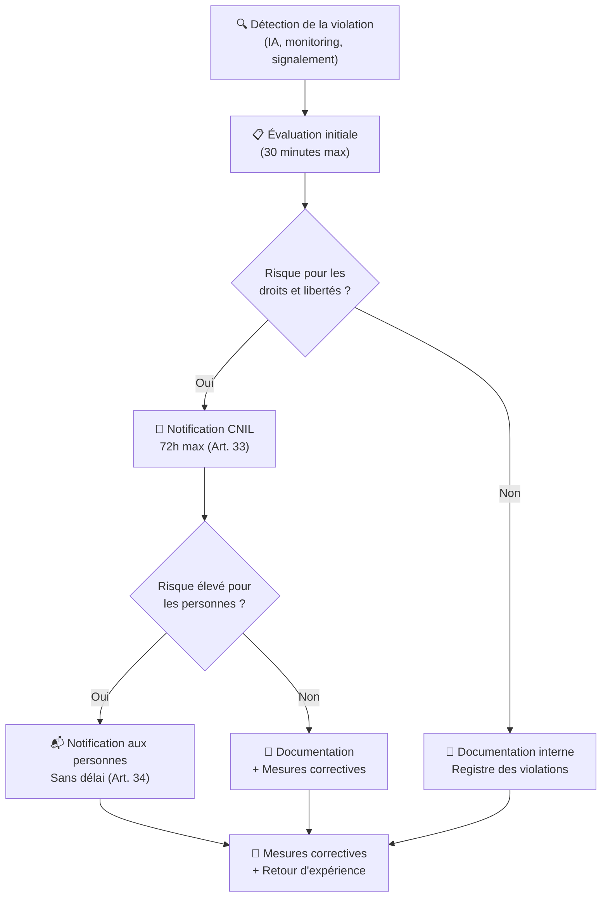

# 📜 Conformité RGPD — Télémédecine Sécurisée

> Document de conformité au Règlement Général sur la Protection des Données (UE 2016/679).  
> **Version** : 1.0.0 | **Dernière mise à jour** : 2026-10-23 | **Auteur** : henri983  
> **Classification** : Confidentiel — Données de santé

---

## 📑 Table des matières

- [Introduction](#introduction)
- [Bases légales des traitements](#bases-légales-des-traitements)
- [Registre des traitements](#registre-des-traitements)
- [Droits des personnes concernées](#droits-des-personnes-concernées)
- [Mesures techniques](#mesures-techniques)
- [Mesures organisationnelles](#mesures-organisationnelles)
- [Gestion des violations de données](#gestion-des-violations-de-données)
- [Transferts de données](#transferts-de-données)
- [Délégué à la Protection des Données (DPO)](#délégué-à-la-protection-des-données-dpo)
- [Analyse d'impact (DPIA)](#analyse-dimpact-dpia)

---

## Introduction

La plateforme **Télémédecine Sécurisée** traite des données de santé au sens de l'Article 9 du RGPD (catégories particulières de données personnelles). Ce document décrit l'ensemble des mesures mises en œuvre pour garantir la conformité au RGPD et la protection des droits des personnes concernées.

### Périmètre

Ce document couvre :

- Les traitements de données personnelles réalisés par la plateforme
- Les données des **patients** (données d'identification et données de santé)
- Les données des **praticiens** (données professionnelles)
- Les données des **administrateurs** (données de gestion)

### Cadre réglementaire applicable

| Texte | Référence | Applicabilité |
|-------|-----------|---------------|
| **RGPD** | Règlement (UE) 2016/679 | Ensemble du traitement |
| **Directive ePrivacy** | Directive 2002/58/CE | Communications électroniques |
| **Code de la santé publique** | Articles L.1110-4, L.1111-8 | Données de santé |
| **Référentiel HDS** | ANS / ASIP Santé | Hébergement données de santé |
| **Recommandations CNIL** | Délibérations CNIL | Bonnes pratiques |

---

## Bases légales des traitements

### Article 6 — Licéité du traitement

Les traitements de données personnelles effectués par la plateforme reposent sur les bases légales suivantes :

| Traitement | Base légale (Art. 6) | Justification |
|------------|---------------------|---------------|
| Création de compte | **6.1.b** — Exécution du contrat | Nécessaire à la fourniture du service de télémédecine |
| Authentification | **6.1.b** — Exécution du contrat | Nécessaire à l'accès sécurisé au service |
| Gestion des consultations | **6.1.b** — Exécution du contrat | Objet principal du service |
| Facturation | **6.1.b** — Exécution du contrat | Exécution de l'obligation contractuelle |
| Logs d'audit | **6.1.c** — Obligation légale | Traçabilité imposée pour les données de santé |
| Détection IA | **6.1.f** — Intérêt légitime | Protection contre les accès frauduleux |
| Conservation légale | **6.1.c** — Obligation légale | Obligations de conservation (Code de la santé publique) |

### Article 9 — Données de santé (catégories particulières)

Le traitement de données de santé est autorisé sur la base de :

| Exception Art. 9 | Fondement | Application |
|-------------------|-----------|-------------|
| **9.2.a** — Consentement explicite | Consentement libre, spécifique, éclairé et univoque | Recueilli lors de la création du compte patient |
| **9.2.h** — Finalités médicales | Médecine préventive, diagnostics médicaux, prise en charge sanitaire | Consultations de télémédecine |

**Modalités de recueil du consentement :**

- ✅ Consentement **libre** : aucune contrainte, possibilité de refuser sans conséquence
- ✅ Consentement **spécifique** : pour chaque finalité de traitement distincte
- ✅ Consentement **éclairé** : information claire et compréhensible fournie préalablement
- ✅ Consentement **univoque** : acte positif clair (case à cocher non pré-cochée)
- ✅ Consentement **documenté** : horodaté et conservé comme preuve
- ✅ Consentement **révocable** : retrait possible à tout moment via l'interface

---

## Registre des traitements

*Conformément à l'Article 30 du RGPD*

### Traitement 1 : Gestion des comptes utilisateurs

| Champ | Détail |
|-------|--------|
| **Responsable du traitement** | Opérateur de la plateforme Télémédecine Sécurisée |
| **Finalité** | Création et gestion des comptes utilisateurs (patients, praticiens, administrateurs) |
| **Base légale** | Art. 6.1.b — Exécution du contrat |
| **Catégories de personnes** | Patients, praticiens, administrateurs |
| **Données collectées** | Nom, prénom, email, téléphone, rôle, date de création |
| **Durée de conservation** | Durée de la relation contractuelle + 3 ans après suppression du compte |
| **Destinataires** | Personnel habilité uniquement (praticiens traitants, administrateurs) |
| **Transfert hors UE** | ❌ Aucun |
| **Mesures de sécurité** | Chiffrement AES-256-GCM, hachage Argon2id, RBAC |

### Traitement 2 : Gestion des consultations médicales

| Champ | Détail |
|-------|--------|
| **Responsable du traitement** | Opérateur de la plateforme Télémédecine Sécurisée |
| **Finalité** | Réalisation et suivi des consultations de télémédecine |
| **Base légale** | Art. 6.1.b — Exécution du contrat, Art. 9.2.h — Finalités médicales |
| **Catégories de personnes** | Patients, praticiens |
| **Données collectées** | Date, motif, diagnostic, prescription, notes cliniques |
| **Durée de conservation** | 20 ans à compter de la dernière consultation (Art. R.1112-7 CSP) |
| **Destinataires** | Praticien traitant, patient concerné |
| **Transfert hors UE** | ❌ Aucun |
| **Mesures de sécurité** | Chiffrement AES-256-GCM, contrôle d'accès strict, audit trail |

### Traitement 3 : Gestion des dossiers médicaux

| Champ | Détail |
|-------|--------|
| **Responsable du traitement** | Opérateur de la plateforme Télémédecine Sécurisée |
| **Finalité** | Conservation et mise à disposition des dossiers médicaux des patients |
| **Base légale** | Art. 6.1.c — Obligation légale, Art. 9.2.h — Finalités médicales |
| **Catégories de personnes** | Patients |
| **Données collectées** | Antécédents, allergies, traitements, résultats d'examens, historique médical |
| **Durée de conservation** | 20 ans à compter de la dernière consultation (Art. R.1112-7 CSP) |
| **Destinataires** | Praticien traitant, patient concerné |
| **Transfert hors UE** | ❌ Aucun |
| **Mesures de sécurité** | Chiffrement AES-256-GCM, pseudonymisation, contrôle d'accès strict |

### Traitement 4 : Détection de comportements suspects par IA

| Champ | Détail |
|-------|--------|
| **Responsable du traitement** | Opérateur de la plateforme Télémédecine Sécurisée |
| **Finalité** | Détection d'accès frauduleux et protection des données de santé |
| **Base légale** | Art. 6.1.f — Intérêt légitime (sécurité du système et des données) |
| **Catégories de personnes** | Tous les utilisateurs de la plateforme |
| **Données collectées** | Métadonnées de requêtes (fréquence, horaire, volume, patterns d'accès) — **aucune donnée médicale** |
| **Durée de conservation** | 12 mois glissants |
| **Destinataires** | Administrateurs, équipe sécurité |
| **Transfert hors UE** | ❌ Aucun |
| **Mesures de sécurité** | Pseudonymisation des identifiants, logs sans PII |

### Traitement 5 : Logs d'audit et traçabilité

| Champ | Détail |
|-------|--------|
| **Responsable du traitement** | Opérateur de la plateforme Télémédecine Sécurisée |
| **Finalité** | Traçabilité des accès aux données de santé (obligation légale) |
| **Base légale** | Art. 6.1.c — Obligation légale (Code de la santé publique) |
| **Catégories de personnes** | Tous les utilisateurs |
| **Données collectées** | Identifiant pseudonymisé, action réalisée, horodatage, adresse IP hashée |
| **Durée de conservation** | 6 ans (délai de prescription légale) |
| **Destinataires** | Administrateurs, autorités compétentes (sur demande légale) |
| **Transfert hors UE** | ❌ Aucun |
| **Mesures de sécurité** | Pseudonymisation, intégrité garantie (append-only), chiffrement |

---

## Droits des personnes concernées

La plateforme implémente l'ensemble des droits prévus par le Chapitre III du RGPD. Chaque droit est exercable via l'API REST ou par demande écrite au DPO.

### Droit d'accès (Article 15)

> *Toute personne a le droit d'obtenir la confirmation que ses données personnelles font l'objet d'un traitement et, le cas échéant, l'accès auxdites données.*

| Aspect | Détail |
|--------|--------|
| **Endpoint API** | `GET /api/v1/rgpd/access` |
| **Délai de réponse** | 30 jours maximum (Article 12.3) |
| **Format** | JSON structuré contenant toutes les données personnelles |
| **Authentification** | JWT valide + vérification d'identité renforcée |
| **Contenu** | Données personnelles, finalités, destinataires, durée de conservation, origine des données |
| **Gratuité** | ✅ Première demande gratuite, frais raisonnables en cas de demandes répétitives |
| **Audit** | Chaque exercice du droit d'accès est journalisé dans l'audit trail |

### Droit de rectification (Article 16)

> *La personne concernée a le droit d'obtenir la rectification des données personnelles la concernant qui sont inexactes.*

| Aspect | Détail |
|--------|--------|
| **Endpoint API** | `PUT /api/v1/rgpd/rectify` |
| **Délai de réponse** | 30 jours maximum |
| **Données modifiables** | Nom, prénom, email, téléphone, adresse |
| **Données non modifiables** | Données médicales (rectification via le praticien traitant) |
| **Notification** | Les destinataires des données sont informés de la rectification |
| **Audit** | Historique des modifications conservé |

### Droit à l'effacement (Article 17)

> *La personne concernée a le droit d'obtenir l'effacement de ses données personnelles ("droit à l'oubli").*

| Aspect | Détail |
|--------|--------|
| **Endpoint API** | `DELETE /api/v1/rgpd/erase` |
| **Délai de réponse** | 30 jours maximum |
| **Type d'effacement** | Suppression irréversible (pas de soft delete pour les données personnelles) |
| **Exceptions** | Données médicales soumises à obligation légale de conservation (20 ans — Art. R.1112-7 CSP) |
| **Procédure** | 1. Demande → 2. Vérification identité → 3. Évaluation exceptions → 4. Effacement → 5. Confirmation |
| **Notification** | Information aux sous-traitants et destinataires |
| **Audit** | Log de la suppression (métadonnées uniquement, sans les données supprimées) |

### Droit à la portabilité (Article 20)

> *La personne concernée a le droit de recevoir ses données dans un format structuré, couramment utilisé et lisible par machine.*

| Aspect | Détail |
|--------|--------|
| **Endpoint API** | `GET /api/v1/rgpd/export` |
| **Délai de réponse** | 30 jours maximum |
| **Formats disponibles** | JSON, CSV |
| **Données incluses** | Toutes les données fournies par l'utilisateur et les données générées par le traitement |
| **Données exclues** | Logs d'audit (traitement basé sur l'obligation légale, pas le consentement) |
| **Sécurité** | Export chiffré, lien de téléchargement temporaire (24h) |

### Droit d'opposition (Article 21)

> *La personne concernée a le droit de s'opposer au traitement de ses données personnelles.*

| Aspect | Détail |
|--------|--------|
| **Endpoint API** | `POST /api/v1/rgpd/object` |
| **Délai de réponse** | 30 jours maximum |
| **Traitements concernés** | Détection IA (intérêt légitime), profilage |
| **Traitements exclus** | Conservation légale des données de santé (obligation légale) |
| **Procédure** | 1. Demande motivée → 2. Évaluation → 3. Arrêt du traitement ou refus motivé |
| **Conséquence** | Désactivation de la détection IA pour l'utilisateur concerné |

### Synthèse des délais

| Droit | Délai légal | Délai objectif plateforme | Prolongation possible |
|-------|-------------|---------------------------|----------------------|
| Accès | 30 jours | 7 jours | +2 mois (complexité) |
| Rectification | 30 jours | 48h | +2 mois (complexité) |
| Effacement | 30 jours | 7 jours | +2 mois (complexité) |
| Portabilité | 30 jours | 48h | +2 mois (complexité) |
| Opposition | 30 jours | 48h | +2 mois (complexité) |

---

## Mesures techniques

### Chiffrement

| Couche | Algorithme | Standard | Détail |
|--------|-----------|----------|--------|
| **Données au repos** | AES-256-GCM | NIST SP 800-38D | Toutes les données médicales sont chiffrées avant stockage en base |
| **Données en transit** | TLS 1.3 | RFC 8446 | HTTPS obligatoire, HSTS activé |
| **Mots de passe** | Argon2id | RFC 9106 | memory_cost=65536, time_cost=3, parallelism=4 |
| **Clés de chiffrement** | HKDF-SHA256 | RFC 5869 | Dérivation sécurisée des clés |

### Pseudonymisation

- Les **identifiants utilisateurs** sont hashés (SHA-256 tronqué) dans tous les logs et métriques
- Les **adresses IP** sont hashées avec un sel rotatif dans les logs d'audit
- Les **noms et prénoms** ne sont jamais présents dans les logs applicatifs
- Les **identifiants de session** sont pseudonymisés dans les métriques Prometheus

### Contrôle d'accès

| Mécanisme | Implémentation | Détail |
|-----------|---------------|--------|
| **Authentification** | JWT (HMAC-SHA256) | Access token 15 min, refresh token 7 jours |
| **Autorisation** | RBAC hiérarchique | 3 rôles : Admin, Praticien, Patient |
| **Anti brute-force** | Rate limiting Redis | 5 tentatives / 15 min par IP (authentification) |
| **Session** | Redis externalisé | Invalidation immédiate possible, TTL automatique |
| **MFA** | TOTP (prévu v1.1) | Authentification multi-facteurs pour les praticiens |

### Sécurité applicative

| Protection | Implémentation | Référence OWASP |
|-----------|---------------|-----------------|
| **Injection SQL** | ORM SQLAlchemy (requêtes paramétrées) | A03:2021 |
| **XSS** | Content-Security-Policy header | A03:2021 |
| **CSRF** | SameSite cookies + CORS strict | A01:2021 |
| **Clickjacking** | X-Frame-Options: DENY | A05:2021 |
| **MIME Sniffing** | X-Content-Type-Options: nosniff | A05:2021 |
| **Composants vulnérables** | Safety + Trivy (CI/CD) | A06:2021 |

---

## Mesures organisationnelles

### Politique de sécurité de l'information

- **Politique de mots de passe** : minimum 12 caractères, complexité requise, renouvellement annuel
- **Principe du moindre privilège** : chaque utilisateur n'a accès qu'aux données nécessaires à sa fonction
- **Séparation des environnements** : développement, staging et production strictement séparés
- **Gestion des accès** : revue trimestrielle des droits d'accès

### Formation et sensibilisation

| Public | Fréquence | Contenu |
|--------|-----------|---------|
| **Développeurs** | Semestrielle | Développement sécurisé, OWASP Top 10, bonnes pratiques RGPD |
| **Administrateurs** | Trimestrielle | Gestion des incidents, procédures de sécurité |
| **Praticiens** | Annuelle | Obligations de confidentialité, utilisation sécurisée de la plateforme |

### Audits

| Type d'audit | Fréquence | Périmètre |
|-------------|-----------|-----------|
| **Audit de code** | Continue (CI/CD) | Analyse statique (Bandit), revue de code (PR) |
| **Audit de sécurité** | Annuel | Pentest externe, analyse de vulnérabilités |
| **Audit RGPD** | Annuel | Conformité des traitements, registre, droits |
| **Audit d'accès** | Trimestriel | Revue des droits, sessions actives, logs |

### Gestion des sous-traitants

Tout sous-traitant ayant accès aux données personnelles doit :

1. Signer un **contrat de sous-traitance** conforme à l'Article 28 du RGPD
2. Présenter des **garanties suffisantes** de mesures techniques et organisationnelles
3. Ne traiter les données que sur **instruction documentée** du responsable de traitement
4. Être soumis à une **obligation de confidentialité**
5. Assister le responsable de traitement dans l'exercice des **droits des personnes**
6. Supprimer ou restituer les données à la **fin du contrat**

---

## Gestion des violations de données

*Conformément aux Articles 33 et 34 du RGPD*

### Définition

Une violation de données personnelles est une violation de la sécurité entraînant, de manière accidentelle ou illicite, la destruction, la perte, l'altération, la divulgation non autorisée ou l'accès non autorisé à des données personnelles.

### Procédure de notification

### Contenu de la notification CNIL (Article 33)

| Information | Détail |
|-------------|--------|
| Nature de la violation | Description de la violation et catégories de données concernées |
| Nombre de personnes | Nombre approximatif de personnes concernées |
| Conséquences probables | Évaluation des conséquences pour les personnes |
| Mesures prises | Mesures pour remédier à la violation et atténuer les effets |
| Coordonnées DPO | Contact du Délégué à la Protection des Données |

### Contenu de la notification aux personnes (Article 34)

- Description de la violation en termes clairs
- Coordonnées du DPO
- Conséquences probables de la violation
- Mesures prises et recommandations (changement de mot de passe, etc.)

### Registre des violations

Toutes les violations sont documentées dans un registre interne contenant :

- Date et heure de la détection
- Nature et circonstances de la violation
- Données et personnes concernées
- Conséquences évaluées
- Mesures correctives prises
- Notifications effectuées (CNIL, personnes)
- Retour d'expérience

---

## Transferts de données

### Principe : aucun transfert hors UE

La plateforme **Télémédecine Sécurisée** ne réalise **aucun transfert de données personnelles** en dehors de l'Union Européenne ou de l'Espace Économique Européen.

| Aspect | Détail |
|--------|--------|
| **Hébergement** | Serveurs situés en France (hébergeur certifié HDS) |
| **Base de données** | PostgreSQL hébergé en France |
| **Cache** | Redis hébergé en France |
| **Sous-traitants** | Tous localisés dans l'UE |
| **Sauvegardes** | Stockées en France, chiffrées AES-256 |
| **CDN** | Non applicable (API uniquement) |

### Garanties

- Aucun service cloud américain (pas de GAFAM) pour les données de santé
- Hébergeur certifié **HDS** (Hébergement de Données de Santé)
- Contrats de sous-traitance conformes à l'Article 28 du RGPD
- Audit annuel de la localisation effective des données

---

## Délégué à la Protection des Données (DPO)

### Coordonnées

| Information | Détail |
|-------------|--------|
| **Fonction** | Délégué à la Protection des Données |
| **Contact** | dpo@telemedecine-securisee.fr |
| **Délai de réponse** | 30 jours maximum |
| **Disponibilité** | Lundi au vendredi, 9h-18h |

### Missions du DPO

1. **Informer et conseiller** le responsable de traitement et les employés
2. **Contrôler le respect** du RGPD et des politiques internes
3. **Coopérer avec la CNIL** et servir de point de contact
4. **Tenir le registre** des traitements
5. **Réaliser les DPIA** (analyses d'impact) lorsque nécessaire
6. **Gérer les demandes** d'exercice des droits des personnes

---

## Analyse d'impact (DPIA)

Le traitement de données de santé à grande échelle nécessite une Analyse d'Impact relative à la Protection des Données (DPIA) conformément à l'Article 35 du RGPD.

L'analyse d'impact complète est disponible dans le document dédié : **[DPIA.md](DPIA.md)**

### Critères déclenchant le DPIA

- ✅ Traitement de données sensibles (données de santé — Article 9)
- ✅ Traitement à grande échelle
- ✅ Surveillance systématique (détection IA)
- ✅ Données concernant des personnes vulnérables (patients)

### Résultat du DPIA

| Risque identifié | Niveau initial | Mesures d'atténuation | Niveau résiduel |
|-----------------|----------------|----------------------|-----------------|
| Accès non autorisé aux données de santé | 🔴 Critique | Chiffrement AES-256-GCM + RBAC + MFA | 🟢 Faible |
| Fuite de données personnelles | 🔴 Critique | Chiffrement bout en bout + audit trail | 🟢 Faible |
| Profilage non consenti (IA) | 🟡 Modéré | Transparence + droit d'opposition | 🟢 Faible |
| Indisponibilité du service | 🟡 Modéré | Sauvegardes chiffrées + PRA | 🟢 Faible |

---

> 📖 Retour au [README principal](../README.md) | 🏗️ [Architecture](ARCHITECTURE.md) | 🔐 [Sécurité](SECURITY.md) | 📊 [DPIA](DPIA.md)
