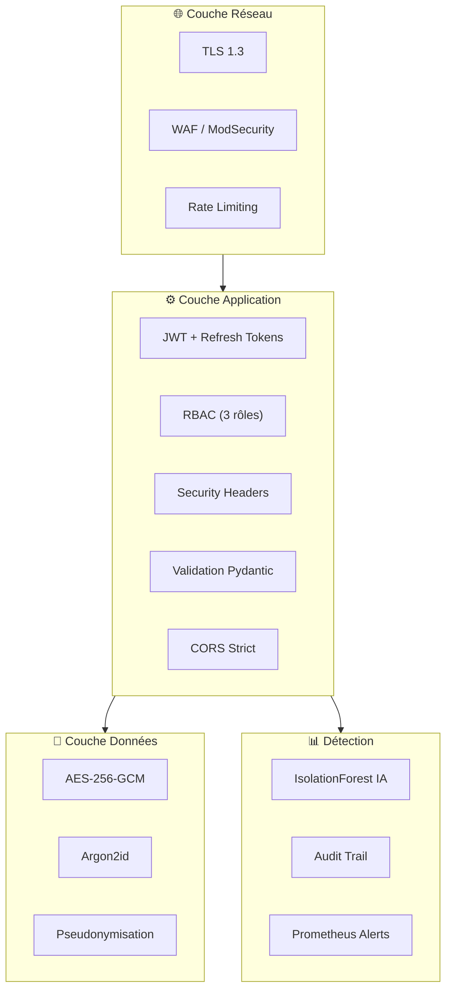
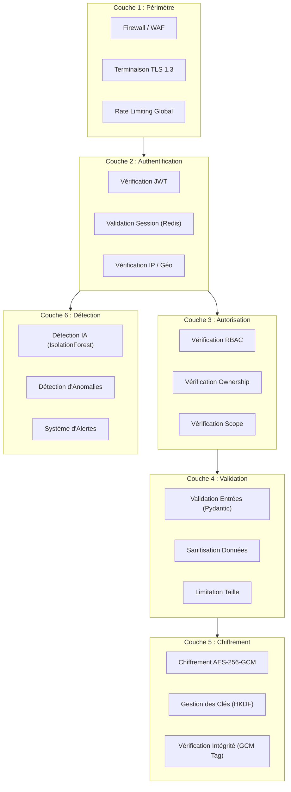
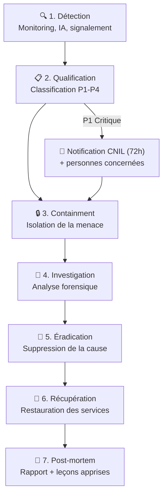

# 🔐 Politique de Sécurité — Télémédecine Sécurisée

> Politique de sécurité et procédure de divulgation responsable des vulnérabilités.  
> **Version** : 1.0.0 | **Dernière mise à jour** : 2026-10-23 | **Auteur** : henri983  
> **Classification** : Public

---

## 📑 Table des matières

- [Versions supportées](#versions-supportées)
- [Signalement de vulnérabilités](#signalement-de-vulnérabilités)
- [Mesures de sécurité implémentées](#mesures-de-sécurité-implémentées)
- [Architecture de sécurité](#architecture-de-sécurité)
- [Gestion des secrets](#gestion-des-secrets)
- [Processus d'audit](#processus-daudit)
- [Plan de réponse aux incidents](#plan-de-réponse-aux-incidents)
- [Contact sécurité](#contact-sécurité)

---

## Versions supportées

| Version | Supportée | Fin de support |Notes |
|---------|-----------|----------------|------|
| **1.0.x** | ✅ Oui | — | Version actuelle, mises à jour de sécurité actives |
| < 1.0.0 | ❌ Non | — | Versions de développement, non supportées |

### Politique de mises à jour

- **Correctifs critiques (CVSS ≥ 9.0)** : Patch sous 24h, déploiement immédiat
- **Correctifs élevés (CVSS 7.0-8.9)** : Patch sous 72h
- **Correctifs modérés (CVSS 4.0-6.9)** : Patch dans le prochain sprint (2 semaines)
- **Correctifs faibles (CVSS < 4.0)** : Patch dans la prochaine release mineure

---

## Signalement de vulnérabilités

### Procédure de divulgation responsable (Responsible Disclosure)

Nous prenons la sécurité de notre plateforme très au sérieux. Si vous découvrez une vulnérabilité, nous vous encourageons à nous la signaler de manière responsable.

#### Comment signaler

| Méthode | Détail |
|---------|--------|
| **Email** | security@telemedecine-securisee.fr |
| **Chiffrement** | Clé PGP disponible sur demande |
| **Langue** | Français ou anglais |
| **Délai d'accusé de réception** | 48h maximum |

#### Informations à inclure

Pour nous aider à analyser et corriger la vulnérabilité rapidement, merci d'inclure :

1. **Description** de la vulnérabilité
2. **Étapes de reproduction** détaillées
3. **Impact** potentiel évalué
4. **Preuve de concept** (PoC) si disponible
5. **Versions affectées**
6. **Suggestions de correction** (optionnel)

#### Notre engagement

| Engagement | Détail |
|------------|--------|
| **Accusé de réception** | Sous 48h |
| **Évaluation initiale** | Sous 5 jours ouvrés |
| **Correction** | Selon la criticité (voir politique ci-dessus) |
| **Crédit** | Mention dans le changelog et le Hall of Fame (si souhaité) |
| **Non-poursuite** | Pas de poursuites judiciaires pour les chercheurs agissant de bonne foi |

#### Ce que nous vous demandons

- ❌ **Ne pas** divulguer publiquement la vulnérabilité avant la correction
- ❌ **Ne pas** accéder, modifier ou supprimer des données d'autres utilisateurs
- ❌ **Ne pas** effectuer de test de déni de service (DoS/DDoS)
- ❌ **Ne pas** utiliser d'outils automatisés agressifs sur la production
- ✅ **Nous accorder** un délai raisonnable pour corriger (90 jours)

---

## Mesures de sécurité implémentées

### Synthèse des protections



### Détail des mesures

#### Chiffrement

| Aspect | Algorithme | Standard | Configuration |
|--------|-----------|----------|---------------|
| Données au repos | AES-256-GCM | NIST SP 800-38D | Nonce 96 bits, tag 128 bits |
| Données en transit | TLS 1.3 | RFC 8446 | Suites de chiffrement modernes uniquement |
| Mots de passe | Argon2id | RFC 9106 | memory=65536 KiB, iterations=3, parallelism=4 |
| Dérivation de clés | HKDF-SHA256 | RFC 5869 | Salt aléatoire par clé dérivée |
| Signatures JWT | HMAC-SHA256 | RFC 7519 | Secret ≥ 256 bits |

#### Authentification et autorisation

| Mécanisme | Configuration | Objectif |
|-----------|---------------|----------|
| Access Token JWT | Expiration : 15 minutes | Authentification courte durée |
| Refresh Token | Expiration : 7 jours, rotation à chaque usage | Renouvellement sécurisé |
| Blacklisting | Redis TTL | Invalidation immédiate de tokens |
| RBAC | 3 rôles (Admin, Praticien, Patient) | Moindre privilège |
| Rate Limiting (auth) | 5 tentatives / 15 minutes / IP | Anti brute-force |
| Rate Limiting (API) | 100 requêtes / minute / utilisateur | Anti abus |

#### Headers de sécurité HTTP

| Header | Valeur | Protection |
|--------|--------|-----------|
| `Strict-Transport-Security` | `max-age=63072000; includeSubDomains; preload` | Force HTTPS (2 ans) |
| `Content-Security-Policy` | `default-src 'self'; script-src 'self'; style-src 'self' 'unsafe-inline'` | Prévention XSS |
| `X-Frame-Options` | `DENY` | Prévention clickjacking |
| `X-Content-Type-Options` | `nosniff` | Prévention MIME sniffing |
| `Referrer-Policy` | `strict-origin-when-cross-origin` | Limitation fuite d'URL |
| `Permissions-Policy` | `camera=(), microphone=(), geolocation=()` | Restriction API navigateur |
| `X-XSS-Protection` | `0` | Désactivé (CSP suffit, évite les bugs de filtre) |
| `Cache-Control` | `no-store, no-cache, must-revalidate` | Pas de cache pour les données sensibles |

#### Protection OWASP Top 10 (2021)

| # | Risque OWASP | Mesure implémentée |
|---|-------------|-------------------|
| A01 | Broken Access Control | RBAC strict, vérification ownership, tests automatisés |
| A02 | Cryptographic Failures | AES-256-GCM, TLS 1.3, Argon2id, pas de secrets en dur |
| A03 | Injection | ORM SQLAlchemy (requêtes paramétrées), validation Pydantic |
| A04 | Insecure Design | Threat modeling, DPIA, security by design |
| A05 | Security Misconfiguration | Headers sécurisés, pas de mode debug en prod, .env séparé |
| A06 | Vulnerable Components | Safety + Trivy dans CI/CD, mises à jour régulières |
| A07 | Authentication Failures | Argon2id, JWT court, rate limiting, refresh rotation |
| A08 | Data Integrity Failures | Signature JWT, tag GCM, CI/CD sécurisé |
| A09 | Logging & Monitoring | structlog JSON, Prometheus, alertes, audit trail |
| A10 | SSRF | Pas de requêtes sortantes dynamiques, whitelist stricte |

---

## Architecture de sécurité

### Défense en profondeur



### Principe du moindre privilège

| Rôle | Patients | Ses consultations | Dossiers médicaux | Gestion utilisateurs | Configuration | Audit |
|------|----------|-------------------|-------------------|---------------------|---------------|-------|
| 🟢 **Patient** | Ses données uniquement | Lecture seule | Lecture seule (ses données) | ❌ | ❌ | ❌ |
| 🟡 **Praticien** | Ses patients | Lecture + écriture (ses patients) | Lecture + écriture (ses patients) | ❌ | ❌ | ❌ |
| 🔴 **Admin** | Tous (métadonnées) | Lecture seule (audit) | ❌ (pas d'accès médical) | ✅ | ✅ | ✅ |

> **Note** : Les administrateurs n'ont **pas** accès au contenu des données médicales. Ils peuvent uniquement voir les métadonnées (dates, identifiants pseudonymisés) à des fins d'audit.

---

## Gestion des secrets

### Principes

- ❌ **Aucun secret en dur dans le code** (vérifié par CI/CD)
- ❌ **Aucun secret dans les logs**
- ❌ **Aucun secret dans le contrôle de version** (.gitignore strict)
- ✅ **Variables d'environnement** pour la configuration sensible
- ✅ **Fichier `.env`** exclu du dépôt Git (`.env.example` fourni comme template)

### Inventaire des secrets

| Secret | Stockage | Rotation | Usage |
|--------|----------|----------|-------|
| `DATABASE_URL` | Variable d'environnement | À chaque déploiement (mot de passe) | Connexion PostgreSQL |
| `REDIS_URL` | Variable d'environnement | À chaque déploiement | Connexion Redis |
| `JWT_SECRET_KEY` | Variable d'environnement | Trimestrielle | Signature des JWT |
| `ENCRYPTION_KEY` | Variable d'environnement | Annuelle (avec re-chiffrement) | Clé maîtresse AES-256 |
| `ENCRYPTION_SALT` | Variable d'environnement | Avec la clé | Sel pour HKDF |

### Bonnes pratiques

```bash
# ❌ NE JAMAIS FAIRE
JWT_SECRET = "mon_secret_en_dur"  # Secret dans le code
git add .env                       # Secret dans le dépôt

# ✅ BONNE PRATIQUE
import os
JWT_SECRET = os.environ["JWT_SECRET_KEY"]  # Variable d'environnement
# .env dans .gitignore
```

---

## Processus d'audit

### Audit continu (CI/CD)

| Outil | Type | Fréquence | Cible |
|-------|------|-----------|-------|
| **Bandit** | SAST (Static Application Security Testing) | Chaque commit/PR | Code Python |
| **Safety** | SCA (Software Composition Analysis) | Chaque commit/PR | Dépendances Python |
| **Trivy** | Container Scanning | Chaque build | Image Docker |
| **MyPy** | Type Checking | Chaque commit/PR | Typage statique |
| **Ruff** | Linting sécurité | Chaque commit/PR | Règles de sécurité |

### Audit périodique

| Type | Fréquence | Responsable | Livrables |
|------|-----------|-------------|-----------|
| **Revue de code sécurité** | Chaque PR | Équipe Dev | Approbation sécurité requise |
| **Revue des droits d'accès** | Trimestrielle | Admin | Rapport des habilitations |
| **Revue des logs d'audit** | Mensuelle | RSSI | Rapport d'anomalies |
| **Test d'intrusion** | Annuel | Prestataire externe | Rapport de pentest |
| **Audit RGPD** | Annuel | DPO | Rapport de conformité |
| **Revue du DPIA** | Annuel | DPO | DPIA mis à jour |

### Audit trail

Toutes les actions sensibles sont journalisées dans un audit trail immuable :

| Événement journalisé | Données enregistrées |
|----------------------|---------------------|
| Connexion / Déconnexion | Timestamp, user_id (hashé), IP (hashée), succès/échec |
| Accès à un dossier médical | Timestamp, user_id (hashé), record_id (hashé), action |
| Modification de données | Timestamp, user_id (hashé), entité, champs modifiés |
| Exercice d'un droit RGPD | Timestamp, user_id (hashé), droit exercé, résultat |
| Alerte IA déclenchée | Timestamp, user_id (hashé), score, action prise |
| Changement de rôle / permissions | Timestamp, admin_id (hashé), user_id (hashé), ancien/nouveau rôle |
| Échec d'authentification | Timestamp, IP (hashée), nombre de tentatives |

---

## Plan de réponse aux incidents

### Classification des incidents

| Niveau | Criticité | Exemples | Temps de réponse |
|--------|-----------|----------|-----------------|
| 🔴 **P1 — Critique** | Impact majeur sur les données de santé | Fuite de données, compromission de compte admin, ransomware | < 1h |
| 🟠 **P2 — Élevé** | Impact significatif sur le service | Tentative d'intrusion détectée, vulnérabilité exploitable, DoS | < 4h |
| 🟡 **P3 — Modéré** | Impact limité | Anomalie IA confirmée, tentative de brute-force, vulnérabilité non exploitable | < 24h |
| 🟢 **P4 — Faible** | Impact minimal | Faux positif IA, scan de ports, tentative de phishing bloquée | < 72h |

### Procédure de réponse



### Étapes détaillées

#### 1. Détection

- Alertes Prometheus / Grafana
- Détection IA (IsolationForest)
- Signalement utilisateur
- Scan de vulnérabilités CI/CD

#### 2. Qualification

- Évaluation de l'impact (données concernées, périmètre)
- Classification de la criticité (P1 à P4)
- Activation de l'équipe de réponse appropriée

#### 3. Containment (Confinement)

- Isolation des systèmes compromis
- Blocage des IP/comptes suspects
- Invalidation des sessions et tokens
- Préservation des preuves (logs, snapshots)

#### 4. Investigation

- Analyse des logs d'audit
- Analyse forensique des systèmes
- Identification du vecteur d'attaque
- Évaluation de l'étendue de la compromission

#### 5. Éradication

- Correction de la vulnérabilité exploitée
- Suppression des accès non autorisés
- Rotation des secrets compromis
- Mise à jour des composants vulnérables

#### 6. Récupération

- Restauration des services depuis une sauvegarde saine
- Vérification de l'intégrité des données
- Monitoring renforcé post-incident
- Réactivation progressive des services

#### 7. Post-mortem

- Rédaction du rapport d'incident
- Identification des causes racines
- Plan d'amélioration
- Mise à jour des procédures
- Communication aux parties prenantes

---

## Contact sécurité

| Canal | Coordonnées | Usage |
|-------|-------------|-------|
| **Email sécurité** | security@telemedecine-securisee.fr | Signalement de vulnérabilités |
| **DPO** | dpo@telemedecine-securisee.fr | Questions RGPD et données personnelles |
| **GitHub Issues** | [Issues](https://github.com/henri983/telemedecine-securisee/issues) | Bugs non sensibles uniquement |
| **Urgence sécurité** | security-urgent@telemedecine-securisee.fr | Incidents critiques (P1) |

> ⚠️ **Important** : Ne signalez **jamais** une vulnérabilité de sécurité via les GitHub Issues publiques. Utilisez l'email sécurité pour une divulgation responsable.

---

> 📖 Retour au [README principal](../README.md) | 🏗️ [Architecture](ARCHITECTURE.md) | 📜 [RGPD](RGPD.md) | 📊 [DPIA](DPIA.md)
